<div align="center">

# 🪶 Plume

[English](README.md) | [Français](README.fr.md)

**The sovereign SOC / XDR, light as a feather** — security operations without the heavy stack.
*Rust · SQLite · one small binary · runs in 2 GB · on‑premise, GDPR‑friendly, zero external dependency.*

**·  open source  ·  by [GuatX](https://github.com/guatxlabs)  ·**

**License: [AGPL‑3.0](LICENSE) — 100 % open source**  ·  Advanced modules (open, disabled by default) → [`ADVANCED_MODULES.md`](ADVANCED_MODULES.md)

</div>

<p align="center">
  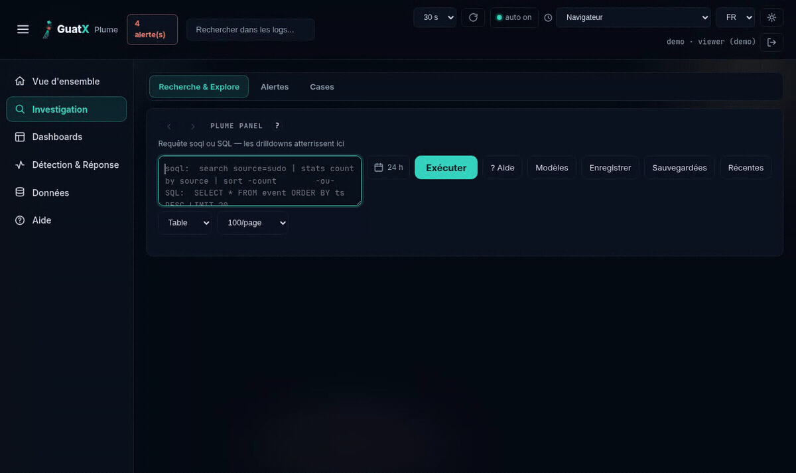
</p>

Plume is the **blue half of a purple SOC**. It ingests **logs and metrics**, then gives you **search
(GXQL)**, **dashboards**, a **detection engine** (rules · Sigma import · ATT&CK coverage · SOAR‑lite
playbooks), **threat‑intel** (IOC/STIX/TAXII matching at ingestion), **risk‑based alerting**, **incident
cases** and **automated response** — all in **one small binary** that you run
on **Docker**, a **bare host (systemd)** or **Kubernetes/k3s**, in **2 GB of RAM**.

> ### 🔴🔵 The purple loop — a SOC that trains against its own attacker
> Plume teams up with **[Forge](https://github.com/guatxlabs/forge)**, the red‑team engine. **Forge launches** an
> authorized engagement → **Plume detects and correlates** each action by its ATT&CK technique → the **coverage
> matrix** turns every miss into a visible blind spot to close. The native **Engagement Mode** lets an
> authorized pentest run through the production SOC **without reconfiguration** (the mode is switched on and off
> live, mode‑off proven byte‑identical by the tests), then
> cleans up automatically and produces a signed report.
>
> *The attack → SIEM → detection validation loop **exists elsewhere**: [Splunk Attack Range](https://github.com/splunk/attack_range)
> (OSS, Splunk Threat Research Team) automates it all the way into CI/CD, [MITRE Caldera](https://github.com/mitre/caldera)
> tools it on the adversary side, and the BAS/AEV market (Cymulate, SafeBreach, Picus) sells it. What **we** have not found
> anywhere is this loop shipped **in a sovereign, self‑hosted suite whose blue half fits in 2 GB** —
> red and blue from the same suite (two repositories, [Plume](https://github.com/guatxlabs/plume) and
> [Forge](https://github.com/guatxlabs/forge)), correlated by ATT&CK technique, with no SaaS and no cluster. If you know a counter‑example,
> [open an issue](https://github.com/guatxlabs/plume/issues): we will correct this sentence.*

### Why Plume
- 🪶 **Light and sovereign** — a single Rust binary (`axum` + `rusqlite`/SQLite, WAL+FTS5) + a vanilla JavaScript PWA with no build step. **Measured: on the order of three hundred MiB of RSS** on the reference profile (**close to ten million events in the database, 2 vCPU, 2 GiB ceiling, masking inactive**); a `count` over that whole database returns in a few seconds under that ceiling. The 2 GiB ceiling is **enforced at runtime, not checked by CI** — measure your own footprint. No American cloud, no cluster to operate.
- 🧩 **Bring‑your‑own‑vendor** — *nothing vendor‑specific is hard‑coded.* Plug in **any** source: a declarative **parsing DSL** (config.d, no rebuild), a **Splunk‑HEC‑compatible** endpoint (point your existing forwarders at Plume), a **generic `http_pull` connector** (any REST API — CrowdStrike/SentinelOne/Defender by plain configuration), or **TAXII 2.1** feeds. *Design goal: not to make you lose capability by migrating. This is not a measured guarantee — no comparison matrix exists in `docs/`; if a capability is missing for you, [open an issue](https://github.com/guatxlabs/plume/issues).*
- 🛡️ **Detection that grows with you** — **Sigma import** (single and bulk) projects the community rule set onto the **ATT&CK coverage matrix**; **threat‑intel** enriches at ingestion; **risk‑based alerting** scores entities to reduce alert fatigue. CIM‑normalized, so that rules compose by *category*, never by vendor.
- 🔐 **Secure and auditable by default** — argon2id + **fail‑closed** RBAC (an unlisted route is refused, not allowed), host‑bound agent tokens, validated read‑only queries, a verifiable **hash‑chained ledger** (`plume-daemon verify`), a hardened container (non‑root, read‑only rootfs, capabilities dropped) and a **default‑deny egress NetworkPolicy** shipped in [`deploy/k3s.yaml`](deploy/k3s.yaml). **No secret in the repository** — open code is a *feature*, not a risk.
  *Two explicit caveats, because an announced flaw is better than a discovered one:* **SQLCipher at‑rest encryption** (per tenant in MSSP mode) is **active on a NEW database** — with no key supplied, the daemon generates one (`0600`, next to the database) on first start: it protects against theft of the disk, not against a compromised machine, and losing it loses the database; a database put into service **before** this rule and left in plaintext **is never converted** by a start ([`docs/CHIFFREMENT-COMPRESSION.md`](docs/CHIFFREMENT-COMPRESSION.md)); and the NetworkPolicy only has an effect if your CNI enforces them (flannel alone does not — [check it](deploy/k3s.yaml), do not assume it).
- 🌍 **Bilingual interface** (FR / EN) + every IANA time zone.

**Architecture** — *Central*: a single Rust binary that ingests, stores and serves the API + the PWA on `:7000`.
*Agents*: dependency‑free `sh` + `systemd` collectors (plugins, disabled by default) that push to the central
(`POST /api/ingest`, bearer token); a multi‑OS endpoint agent (Linux today, Windows/macOS in progress).
The central is also its own agent. In‑depth documentation: [`ARCHITECTURE.md`](ARCHITECTURE.md) ·
**[documentation index](docs/README.md)** (each document carries its state there: shipped / opt-in /
design) — including [SDK](docs/SDK.md) · [CIM](docs/CIM.md) · [parsing DSL](docs/PARSER-DSL.md) ·
[Sigma importer](docs/SIGMA-IMPORTER.md) · [disaster recovery](docs/DR-plume-restore.md).

**To use it**, pages written for the operator rather than for the contributor:
**[install without opening a breach, step by step](docs/INSTALLER-SANS-OUVRIR-DE-BRECHE.md)** ·
[the same operation in all three modes](docs/TROIS-MODES.md) ·
[the console, tab by tab](docs/CONSOLE.md) ·
[the GXQL search language](docs/GXQL.md) ·
[the agents and their protocol](docs/AGENTS-PROTOCOLE.md) ·
[encryption and compression, as they are](docs/CHIFFREMENT-COMPRESSION.md).

## What's included
| Domain | Capability |
|---|---|
| **Search** | GXQL (*GuatX Query Language*, **formerly "SOQL"** — same language, same syntax, only the name changes) — an SPL‑style pipe language compiled to **read‑only, injection‑proof** SQL: allowlisted columns, shape‑constrained identifiers, **escaped literals** (the GXQL path does not use bound parameters — those are on `/api/search`), a single prepared statement, a time budget. Full grammar, bounds and **what the language does not accept**: **[`docs/GXQL.md`](docs/GXQL.md)**. No query, panel or rule needs rewriting; the technical identifiers (route `/api/soql/*`, JSON key `soql`, column `is_soql`, Rust module `guatx_core::soql`) stay `soql`. |
| **Detection** | Rules + SOAR‑lite playbooks · **Sigma import** (single and bulk, with ATT&CK coverage delta) · **ATT&CK coverage matrix** (**14 tactics × 183 techniques** curated — the `guatx_core::attack::CATALOG` catalog, blind spots highlighted). |
| **Threat‑intel** | IOC store · **STIX 2.1** import · **matching at ingestion** (`ti_match`, enrich without deleting) · **TAXII 2.1** feed connector · Bloom‑filter‑based membership for scale. |
| **Risk (RBA)** | Per‑entity risk scoring (Splunk‑ES model) · alerting on risk incidents (cumulative / distinct tactics / velocity) · a single deduplicated alert per entity. |
| **Ingestion** | Agents (sh/systemd) · **Splunk HEC** wire‑compatible endpoint · **generic `http_pull`** connector (bring‑your‑own‑vendor) · syslog + Fortinet parser · declarative parsing DSL. |
| **Response** | **Closed, injection‑proof action vocabulary** (ban_ip / unban_ip / kill_pid / stop_service) with **per‑platform enforcers** (nft/fail2ban/netsh/pfctl/appliance) — dry‑run + approval + allowlist + ledger. |
| **Cases** | Incident cases, triage at scale, export. |
| **Multi‑tenant** | Optional MSSP mode — **per‑tenant SQLCipher** encryption, RBAC groups → tenant/role, audited super‑admin. *(Disabled by default — single‑tenant is bit‑for‑bit identical.)* |
| **Purple** | **Engagement Mode** (authorized pentest through the production SOC, no blind spot, self‑cleanup, signed report) — the junction with [Forge](https://github.com/guatxlabs/forge). |

## Screenshots

**The loop, in four pictures** — a dashboard asks the question, a query answers it, a click drills down
to the event, a regex pipeline turns the answer into an aggregate. 100 % synthetic data (demo
instance, RFC 5737 addresses).

<table>
<tr>
<td width="50%"><a href="docs/img/30-dashboards-live.png">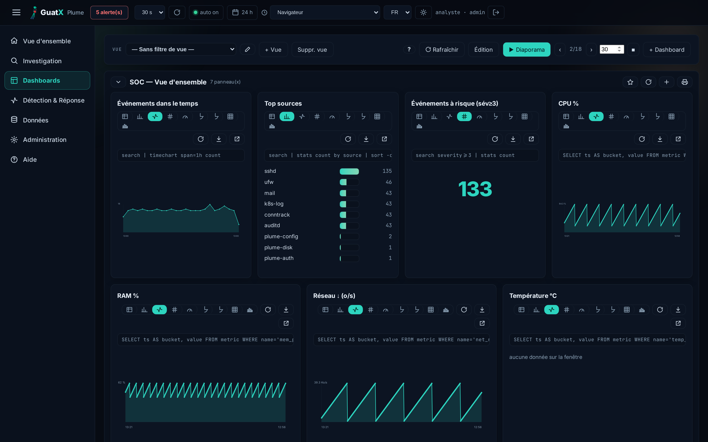</a><br><sub><b>Live dashboards</b> — and <b>every panel shows the query that produces it</b>: a chart is never a black box</sub></td>
<td width="50%"><a href="docs/img/31-recherche-gxql-resultats.png">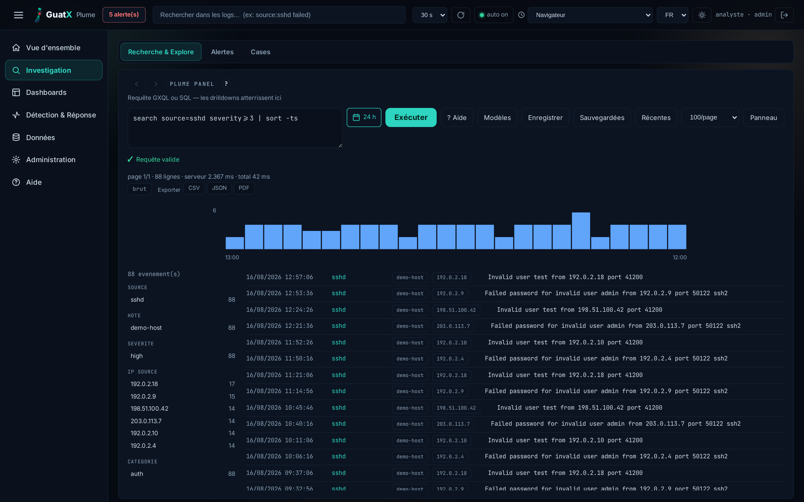</a><br><sub><b>GXQL search → results</b> — live validation, <b>88 rows in 0.66 ms server‑side</b>, time histogram and field facets (source, host, severity, IP); CSV/JSON/PDF export</sub></td>
</tr>
<tr>
<td><a href="docs/img/32-evenement-detaille.png">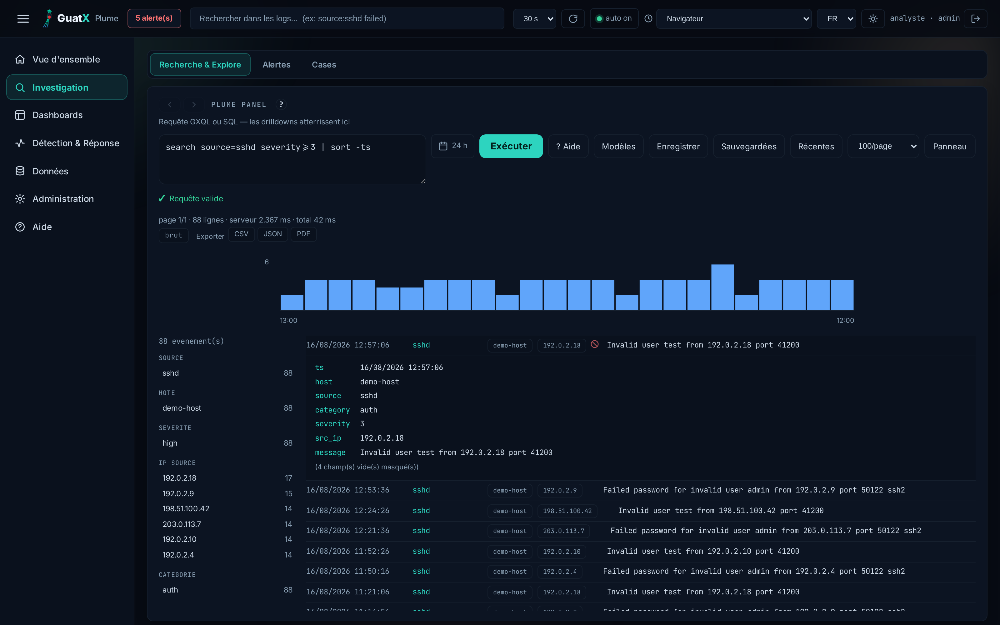</a><br><sub><b>One click on a result</b> expands the whole event — every field, including the count of the empty ones</sub></td>
<td><a href="docs/img/33-regex-rex-agregat.png">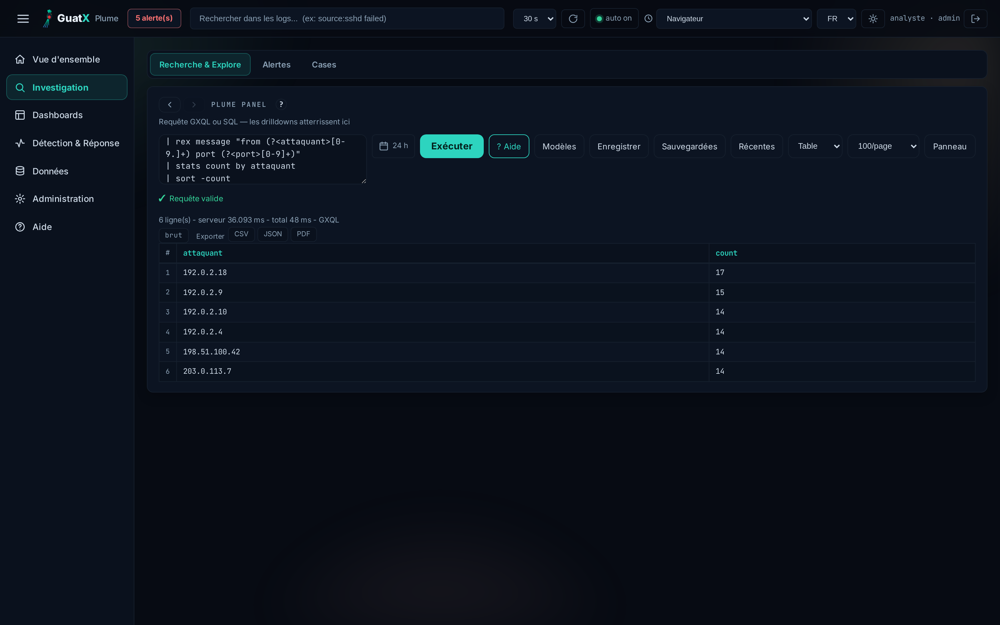</a><br><sub><b>Regex extraction pipeline</b> — <code>rex</code> names groups in the message, then <code>stats</code>/<code>sort</code> aggregate: the attacking IPs come out ranked</sub></td>
</tr>
</table>

<table>
<tr>
<td width="50%"><a href="docs/img/06-dashboard-light.png">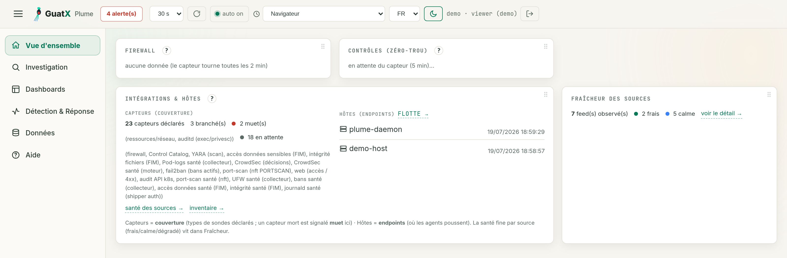</a><br><sub><b>Overview</b> — firewall, controls, hosts and source freshness</sub></td>
<td width="50%"><a href="docs/img/03-explore-gxql.png">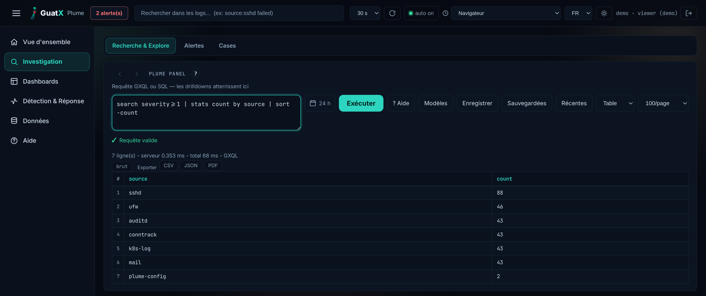</a><br><sub><b>Explore / GXQL</b> — SPL‑style search compiled to safe, read‑only SQL</sub></td>
</tr>
<tr>
<td><a href="docs/img/08-case-detail.png">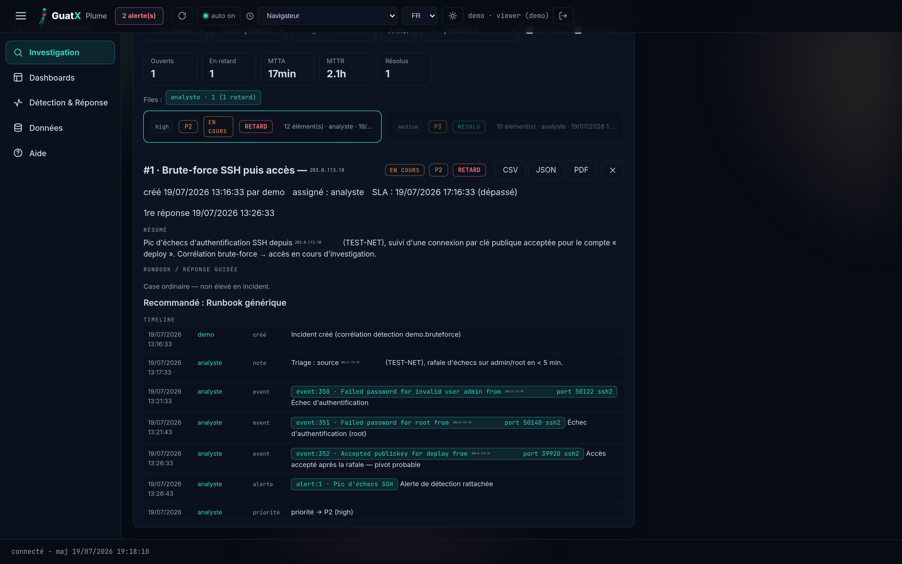</a><br><sub><b>Incident cases</b> — timeline, linked events/alerts, SLA</sub></td>
<td><a href="docs/img/04-attack-matrix.png">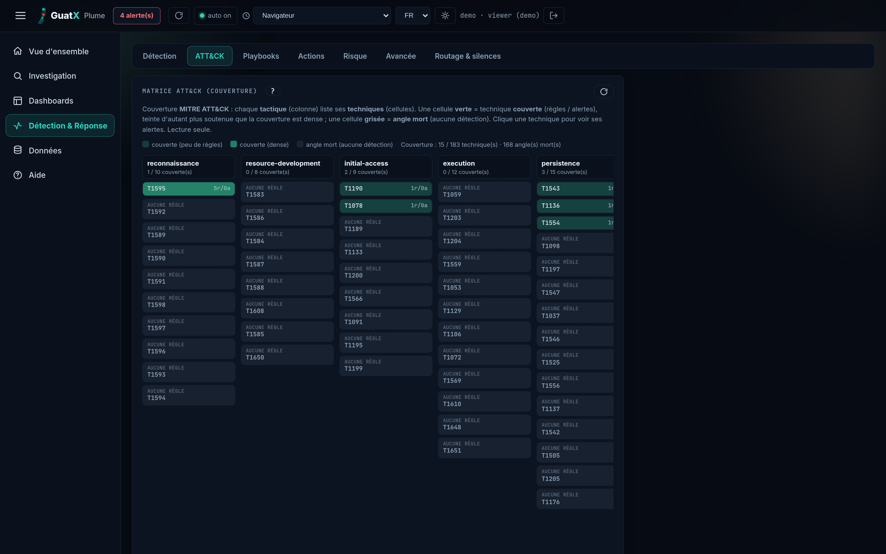</a><br><sub><b>ATT&CK coverage</b> — every miss becomes a visible blind spot</sub></td>
</tr>
<tr>
<td><a href="docs/img/10-inventaire-sources.png">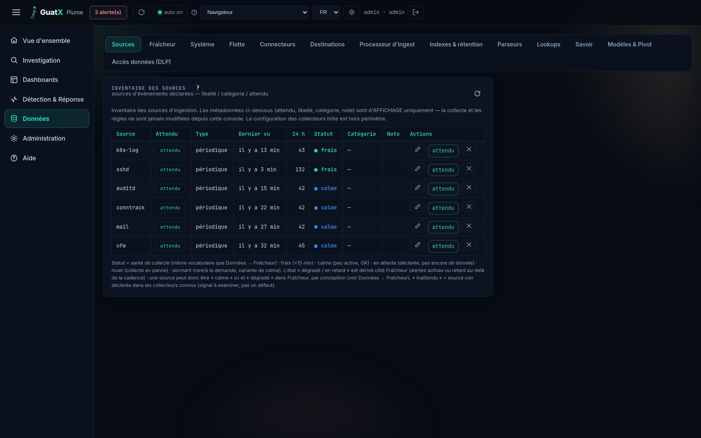</a><br><sub><b>Source inventory</b> — declared feeds, expected vs actual, freshness</sub></td>
<td><a href="docs/img/21-admin-audit.png">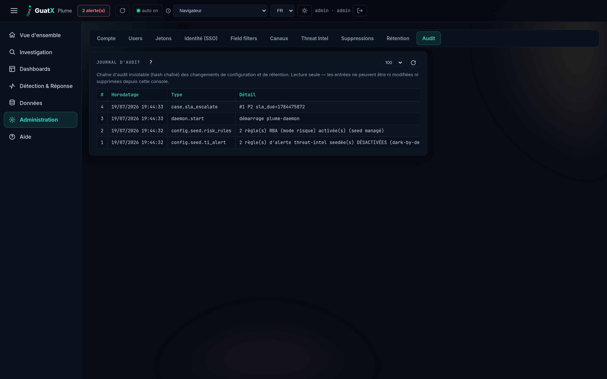</a><br><sub><b>Administration</b> — hash‑chained, verifiable audit ledger</sub></td>
</tr>
</table>

## Installation

The admin password is **never** stored in plaintext: you supply its **argon2id hash** via
`PLUME_PASS_HASH` (generated by the `hashpw` command). Without it, the central starts in **SETUP mode**
(a single‑use installation token printed in the logs → web wizard).

> **Install at home without exposing anything**: what is open by default in each mode, TLS,
> authentication, where each token lives, what each sensor brings into the SIEM and how to
> prove it reports — [`docs/INSTALLER-SANS-OUVRIR-DE-BRECHE.md`](docs/INSTALLER-SANS-OUVRIR-DE-BRECHE.md).

> ### ⚠️ Read before choosing a mode: nothing is pre‑built yet
> **No container image and no binary are published so far** (no `ghcr.io/...`, no
> release artifact). All three modes **compile the daemon from source**. In practice:
> - **Docker** does **not** require a Rust toolchain on your machine: the `Dockerfile` compiles in a
>   `rust:1-bookworm` stage. Docker (with BuildKit) is enough.
> - **Bare host** and **k3s**, on the other hand, require **an installed stable Rust** (`cargo`): the first to
>   produce the binary, the second to produce the image to import.
> - The build pulls crates.io **and** the `guatxlabs/core` git‑dep, at the tag **pinned in
>   [`daemon/Cargo.toml`](daemon/Cargo.toml)** (`grep guatx-core daemon/Cargo.toml` — quoting it here would
>   make it age, and that has already happened) → **network access is required**
>   for the first build. *Build duration and peak memory: not measured on this machine; the `Dockerfile`
>   caps `CARGO_BUILD_JOBS=2` to avoid an OOM on a small machine.*
>
> Publishing an image and signed binaries is **prerequisite no. 1** for a "no toolchain" start;
> it is an acknowledged, known gap, not an oversight.

### A. Docker (the simplest)
From the root of this repository (the build context is the repository itself; `guatx-core` is resolved
via a public git‑dep, no sibling crate required):
```sh
cp .env.example .env
docker compose build soc                             # 1st run: long (compiles the daemon), network required
# the hash is written into .env BETWEEN SINGLE QUOTES — the line below takes care of it:
docker compose run --rm -T soc hashpw 'my-password' | grep -a '^[$]argon2id[$]' | sed "s/.*/PLUME_PASS_HASH='&'/" >> .env
tail -n 1 .env                                       # MUST print PLUME_PASS_HASH='$argon2id$…'
docker compose up -d --build                         # -> http://soc.localhost:7000
```

> ### ⚠️ The hash goes **between single quotes**, and the build is done **separately**
> **Build first.** No image is published: on a fresh clone, `run` **builds**, and
> BuildKit writes its log to **standard output** — hence into the pipe, hence into `.env`.
> *Measured on the bench on 2026‑08‑29:* about fifty stray lines, one of which copies a
> line of the `Dockerfile` that carries quotes; `.env` becomes **unreadable** and Compose then refuses
> **all** of its subcommands, `down` included — you cannot even clean up any more. `build`
> first leaves that log on the screen, where it can be read.
>
> **The `grep` is the second belt**, and its form is derived from what we want: an argon2id hash
> starts with `$argon2id$`, a log line never does (BuildKit prefixes its own with `#<n>`).
> If the build fails, **nothing** passes the filter: `.env` stays intact and **SETUP mode**
> arms itself — loud, rather than a silently wrong hash. *`tail -n 1` would not be enough:* on a
> failed build, the last line is a BuildKit separator, which would become the hash.
>
> **The appended line wins.** It comes **after** the empty `PLUME_PASS_HASH=` line inherited from
> `.env.example`, and in a `.env` **the last one written wins** *(measured)*. If you
> prefer to copy and paste by hand, **replace** that empty line — or write yours **further
> down** — and give it **exactly** this form, quotes included:
> ```
> PLUME_PASS_HASH='$argon2id$v=19$m=19456,t=2,p=1$<sel>$<empreinte>'
> ```
> **Why.** An argon2id hash carries **five `$`**, and Compose reads them in `.env` as the
> start of a **variable**: `$argon2id`, `$v`, `$m`, then the salt and the digest when they
> start with a letter. Each is replaced by an empty string — Compose announces it as
> `… variable is not set`, a warning rarely read — and **what reaches the container
> is no longer the hash**. The **bare** form and the **double‑quoted** form give the *same*
> truncated result; only **single quotes** (which cut interpolation) or **doubled**
> `$` pass the value intact.
>
> **The rule holds for every value in `.env`**, and the costliest is not the hash: it is
> **`PLUME_DB_KEY`**. *Measured on the bench on 2026‑08‑29:* a passphrase `Correct$Horse$Battery9`
> written bare reaches the container as `Correct`, and `$secret$phrase` reaches it **empty** — hence
> "no key", hence a new database that **is born under a generated key** nobody chose,
> while the passphrase put away in safekeeping opens nothing. A truncated hash can be repaired; this cannot.
>
> **The `-T`, stated exactly.** *Measured on the bench on 2026‑08‑29 on Compose 5.5.0:* terminal
> allocation follows the **output** — a pipe allocates none, and the value ends with a bare
> line feed, with or without `-T`. When a terminal **is** allocated (output to the screen), the line
> does end with a **carriage return**, which would enter the value if it were captured
> some other way. `-T` therefore makes that absence **explicit** instead of making it depend on a detection
> that is not a contract.
>
> **What happens then is not an empty value — it is worse.** *Measured on 2026‑08‑29 on hashes
> produced by `hashpw` itself:* the value received is **partial**, never empty, never intact, and
> its length varies with the salt. **SETUP mode** is therefore **not** armed (it requires an *empty* value):
> the daemon starts with a hash that cannot verify any password and **nobody gets in** — neither
> by password nor through the wizard, with no banner and no red line. This is not an open
> installation, it is a **silent lockout**; the remedy is to rewrite `.env` with the single quotes.
> *This trap is specific to Compose: in k3s the hash goes into a `Secret`, which `kubectl` does not interpolate.*

> ### ⚠️ The container is **bounded** — and the adoption of the ceiling is measured first
> The `docker-compose.yml` now sets the four bounds of container mode (memory,
> memory+swap, CPU, processes) plus the **size of `/tmp`** — a tmpfs with no size is
> RAM counted in the same cgroup, hence a way around the first three. All five are set through
> `.env` (`PLUME_MEM_LIMIT`, `PLUME_CPUS`, `PLUME_PIDS_LIMIT`, `PLUME_TMP_SIZE`): nobody has to
> edit a tracked file to change a number. **On a deployment already in service**, first record,
> several times and under load, the share that nothing reclaims when swap is at zero —
> `docker compose exec soc sh -c 'grep "^anon " /sys/fs/cgroup/memory.stat'` — and raise
> `PLUME_MEM_LIMIT` if it approaches the ceiling: exceeding it is not slowness, it is an
> OOM‑kill that `restart: unless-stopped` turns into a loop.

The shipped `docker-compose.yml` **arms** the binary's native ops: a backup scheduler
every 6 h to `/data/backups` (retention of the 24 most recent) + **daily auto‑vacuum**, with no
sidecar and no host cron. Tune them — or switch them off with `PLUME_BACKUP_INTERVAL=0` — via `.env`.

> ⚠️ **The compressed backup requires a database key — and the age of the database decides whether it has one.**
> *Established by reading the tracked tree on 2026‑08‑30:* the compressed path **requires a passphrase**, which is the
> SQLCipher key; the native scheduler, like `plume-daemon backup --compress`, resolves it through
> `db_key()`, whose third origin is the **auto‑generated** key of `P9.6-a`. **On an
> installation made today — a blank Docker volume or PVC — that key is born on first start
> and the cycles publish**, without you having to set anything. **But a database put into service BEFORE
> `P9.6-a` (2026‑08‑25) and left in plaintext never receives one**: a start only generates a key
> for a new database, and its scheduler fails on every pass — a `[backup-sched]` log line plus a
> non‑purgeable posture signal. For that one, set an explicit key or convert it. Host
> mode is outside the subject: its timer calls the subcommand **without** `--compress`, hence
> `VACUUM INTO`, which requires no key — it produces a `.db` copy, not an archive. In every
> case, **prove it** with `plume-daemon backup-verify`: an empty destination directory is a
> failure, not a silence. The three cases, and the verification commands:
> [`docs/CHIFFREMENT-COMPRESSION.md`](docs/CHIFFREMENT-COMPRESSION.md#34-the-precondition-of-the-compressed-path-a-database-key-and-where-it-comes-from).

> 🪶 **Demo (populated, no agents)** — add `PLUME_DEMO=1`: sample events/metrics/alerts over 24 h to see Plume *alive* right away. *(Disabled outside the demo.)*

### B. Bare host (systemd) — a first-class mode, without Docker
```sh
cd daemon && cargo build --release && cd ..          # single binary (stable Rust) — PLAIN build: see just below
sudo bash bootstrap.sh                               # central: daemon + units, :7000 (idempotent)
```

> **In a container or a cluster, this operation does not take this form** (the central is an image, rebuilt then replaced): see [docs/TROIS-MODES.md §1](docs/TROIS-MODES.md) and [docs/TROIS-MODES.md §3.9](docs/TROIS-MODES.md).
**What this compile line does not include.** `cargo build --release` **without `--features`** is the
assumed default of host mode, and it leaves out the **two** optional capabilities that the container
image does compile (`ARG PLUME_FEATURES=ldap,cold_tier`, see [`Dockerfile`](Dockerfile)):
the **columnar cold tier** (`cold_tier`) — without it `PLUME_COLD_TIER` has **no effect** and
Parquet day files written by another binary are **invisible** to it — and the **native LDAP/AD bind**
(`ldap`) — without it `POST /api/auth/ldap` answers **501**. To include them:
`cargo build --release --features cold_tier,ldap`. Both forms are legitimate; what the binary
**actually installed** carries is not a guess — `bootstrap.sh` **queries** it at the end of its run and
prints it (verdict `>> Capacités optionnelles`), and **refuses to conclude** rather than announce a
capability it has not proven.

`bootstrap.sh` **refuses to continue** if `daemon/target/release/plume-daemon` is missing: compile first.
It installs the daemon, the collectors and their units/timers — including **`plume-backup.timer` (daily,
04:00)**, which calls `plume-daemon backup` (compact `VACUUM INTO` copy, rotation at 7). *This host path
differs from the Docker/k3s mode one*: the timer produces an uncompressed `.db` copy, the
in‑daemon scheduler produces an `age(zstd(...))` archive — see [`docs/DR-plume-restore.md`](docs/DR-plume-restore.md).
To align the host with the native scheduler, set `PLUME_BACKUP_INTERVAL` in `/etc/plume/soc.conf` and
disable the timer (`systemctl disable --now plume-backup.timer`). **All** the `PLUME_BACKUP_*` settings
— including the escrow recipient `PLUME_BACKUP_AGE_RECIPIENT` and the fail-closed
`PLUME_BACKUP_REQUIRE_ASYMMETRIC` — are read from that same file (precedence `env > soc.conf > défaut`,
identical in all three deployment modes). *This was not true before 2026-08-09: those two
were read from the environment alone, hence silently ignored on a host — see P8.7-a in
[`docs/ROADMAP.md`](docs/ROADMAP.md).*

Enroll another machine as an agent that pushes to the central:
```sh
sudo env PLUME_CONFIG=/etc/plume/soc.conf /usr/local/bin/plume-daemon token agent-$(hostname) $(hostname)   # on the central — 2nd arg = the BOUND host
# (PLUME_CONFIG: sudo does not pass on the unit's one; without it, the token goes into /var/lib/plume/db/plume.db and the agent is refused)
# (a multi-host forwarder is declared: `plume-daemon token <name> --relais`; the 2-argument form is refused)
# (after the daemon's FIRST start: run before it, the subcommand makes the database be born IN PLAINTEXT — docs/INSTALLER-SANS-OUVRIR-DE-BRECHE.md §1.1)
# on the agent — the token goes through STDIN, NEVER through the command line (see the warning):
umask 077
printf 'PLUME_CENTRAL=%s\nPLUME_TOKEN=%s\n' 'https://central:7000' '<token>' \
  | sudo tee /etc/plume/plume.conf >/dev/null
sudo chmod 0600 /etc/plume/plume.conf   # root only: no `soc` process reads this token (P10.32-j)
sudo bash bootstrap-agent.sh          # conf already present -> kept as is
```

> **In a container or a cluster, this operation does not take this form** (the token and the settings are set in the deployment's `env:`, not by an installer): see [docs/TROIS-MODES.md §3.5](docs/TROIS-MODES.md) and [docs/TROIS-MODES.md §3.2](docs/TROIS-MODES.md).

> ### ⚠️ NEVER pass the token on the command line
> The form `sudo env PLUME_TOKEN='<token>' bash bootstrap-agent.sh` **leaks the token into the SOC
> itself**. `sudo` logs its full command line (`COMMAND=…`); the `journal` collector
> ships those entries to `/api/ingest/journal`, and the daemon stores them **in plaintext** in
> `event.message` **and** `event.fields.command`. *Measured on 2026‑08‑01 on Ubuntu 24.04.4 amd64: the
> enrollment command documented until then produced 6 events containing the token in plaintext; the
> `tee` variant above produces 0, with an identically working agent.* Any SOC **viewer** can
> then read the token (`search source=sudo`) and use it to inject events, impersonate a host
> via HEC/OTLP, or claim an unassigned response action.
> The `journal` collector goes back up to **15 min** on its first run: enabling it *after*
> enrollment does not protect. If the leak has already happened: **revoke and recreate the token**, then
> purge the events concerned.

### C. Kubernetes / k3s
**[`deploy/k3s.yaml`](deploy/k3s.yaml)** is complete and applicable as is: **Namespace + Secret + PVC +
Deployment + Service + Ingress + NetworkPolicy** (*default‑deny* egress, DNS only allowed) — with
native backup enabled. Replace the values to fill in (`PLUME_PASS_HASH`, and `soc.tondomaine.tld` **in both
places**: `PLUME_HOST` and the Ingress — a mismatch triggers the anti‑DNS‑rebinding guard → 421),
build and import the image (multi‑stage `debian‑slim`, non‑root; no registry required), then:
```sh
docker build -t soc:latest .
docker save soc:latest | sudo k3s ctr images import -
kubectl apply -f deploy/k3s.yaml
```
The Ingress ships **TLS‑only**: it only answers on Traefik's `websecure` entrypoint, with the
certificate from the `soc-tls` `Secret` to be created (`kubectl -n soc create secret tls soc-tls --cert=… --key=…`, or
cert-manager); as long as it is missing, Traefik presents its self-signed certificate. Another Ingress
controller ignores these annotations: its HTTP → HTTPS redirect then has to be set up.
The PVC is **1Gi**, a starting value — size it on your actual retention.

### Database encryption (at‑rest) — a new database is born encrypted, an existing database is never converted
**A NEW database is born encrypted**: with no key supplied, the daemon generates its own on first start
(`0600`, at `PLUME_DB_KEY_AUTO_PATH`, otherwise `<PLUME_DB>.key`) and says so. **Put it in safekeeping off the
machine**, then set `PLUME_DB_KEY_ESCROWED=1`. To bring your own key, set it **before the
first start**: `PLUME_DB_KEY_FILE=/chemin/vers/la/cle` (preferred — a file mounted read‑only,
**fail‑closed** if it is missing) or `PLUME_DB_KEY=<passphrase>` (readable via `/proc/<pid>/environ`).
**An EXISTING database is never converted by a start**: a key set on a plaintext database makes the start
**refuse**, naming the explicit and irreversible operation `plume-daemon chiffrer-au-repos`
([`docs/CHIFFREMENT-COMPRESSION.md`](docs/CHIFFREMENT-COMPRESSION.md)).
Both can be set either **in the environment or in the configuration file**
(`/etc/plume/soc.conf` on a host, 0640 — it is even the most discreet place: the file is not
readable via `/proc/<pid>/environ`); the environment wins if it carries the same key. *Before 2026‑08‑09
(P8.7‑b) a key written in the file only encrypted the cold tier and left the hot database in
plaintext, without saying so; if you are in that case, the daemon announces it at start, then **refuses to
start** on that plaintext database until the `chiffrer-au-repos` operation — or until the key is removed, which
restores the previous state.*
**Loss of the key = loss of the database**: keep it off the machine.

### Uninstallation — all three modes

`uninstall.sh` covers **all three** installation modes above. It designates the mode with `--mode`
and **refuses to guess it**: without `--mode` it probes all three and only acts if **exactly one** carries
traces; zero traces, or two modes at once, it says so and stops without touching anything.

```sh
bash uninstall.sh --dry-run                       # inventory of the three modes, no root, modifies nothing
sudo bash uninstall.sh --mode host                # binary + collectors + units + config; KEEPS /var/lib/plume
sudo bash uninstall.sh --mode host --purge        # + database, spool, backups, ledger key, `soc` user
sudo bash uninstall.sh --mode docker              # containers + network of the compose project; KEEPS the volume
sudo bash uninstall.sh --mode docker --purge      # + named volume + `soc:latest` image
bash uninstall.sh --mode k3s                      # PRINTS the plan derived from deploy/k3s.yaml, touches nothing
bash uninstall.sh --mode k3s --apply              # executes; KEEPS the PVC and the Namespace
bash uninstall.sh --mode k3s --apply --purge      # + PVC + Namespace (destructive)
```

**Three properties, and what they cost.**

- **The default operation destroys nothing irreversible.** It removes the software and leaves the
  data. `--purge` **lists what it is going to destroy before doing it** — each path with its
  size, the volume, the PVC, the system user — then asks for confirmation.
- **It reports what it could not remove**, and the **exit code becomes 3**. What
  host mode leaves behind today, and names: the drop‑in directory
  `/etc/systemd/system/plume-<x>.service.d/` if it contains a file that is not plume's; the
  `soc.localhost` line added to `/etc/hosts` by `bootstrap.sh` (**it never edits that shared
  file** — it gives the command); the auditd rules already loaded into the kernel if `augenrules`
  is absent; a `plume-daemon` still alive. In k3s: a resource refused by RBAC, a
  namespace stuck on a *finalizer*, a `PersistentVolume` left `Released`.
- **k3s mode says what to do rather than doing it.** It prints the targeted kubectl context, the
  plan **derived from `deploy/k3s.yaml`** (hence correct even if the manifest changes), and the volume's **reclaim
  policy** read from the cluster — `Delete` destroys the bytes with the PVC, `Retain`
  keeps them and leaves a `Released` PV behind. It only executes with `--apply`. The plan remains printable
  **with no reachable cluster**, and it then says it did not consult the cluster.

Exit codes: `0` finished with no known leftover · `1` usage, permissions, or confirmation impossible ·
`2` mode cannot be determined, **nothing was done** · `3` finished, **leftovers remain** and they
are named.

> **Limits, stated rather than kept quiet.** `uninstall.sh` only knows installations made by
> `bootstrap.sh`, `bootstrap-agent.sh`, `docker-compose.yml` and `deploy/k3s.yaml`: a deployment
> assembled by hand is invisible to it. In docker mode it finds the resources by the **compose
> project name**, which compose derives from the launch **directory** — if you launched
> from elsewhere, give it again with `--project <nom>`. An absent tool (`docker`, `kubectl`) is never
> read as "there is nothing": it is an **impossible probe**, and it is reported as such.
> `--purge` with no terminal **and** no `--yes` **refuses and exits with 1** instead of returning 0 having
> done nothing, which was the previous behaviour.

## Adding your sources and collectors

Plume ingests **any source** with no rebuild and no intervention on our part — three levers, from the simplest to the finest.

**1. A new source, no code ("scripted input").** The generic collector `custom.sh` reads
`/etc/plume/inputs.d/<nom>.input` (`KEY=value`), runs the command and turns each line of its
output into a `source=<SOURCE>` event.

#### End to end, assuming nothing is known

Five operations. None is optional, and the fifth is the one people forget: **proving that the
events arrive**.

**① Install the generic collector.** It is **not** installed by default: `bootstrap-agent.sh`
only installs and arms out of the box `resources integrity ship`. For any other sensor, it is the project's
"golden rule" — install without enabling, the operator decides.

```sh
sudo env PLUME_EXTRA_COLLECTORS="custom" bash bootstrap-agent.sh   # /etc/plume/plume.conf already in place (§ B): it is re-read
```

The token and the central do **not** go through this line: `sudo` logs it in full, and the `journal`
sensor would bring it into the SIEM (see the warning above). On a first installation,
first write `/etc/plume/plume.conf` with `tee`, as in [B](#b-bare-host-systemd--a-first-class-mode-without-docker).

> **In a container or a cluster, this operation does not take this form** (a collection source is added some other way, or does not exist in that mode): see [docs/TROIS-MODES.md §3.3](docs/TROIS-MODES.md).

**② Create the inputs directory.** **No script creates it** — neither `bootstrap.sh`, nor
`bootstrap-agent.sh`, nor the collector itself. Without it, `custom.sh` collects nothing: it emits a
`collect_status=unavailable` / `reason=missing-config` event and exits with 0 (it **says so**, it does not
pretend).

```sh
sudo install -d -o root -g root -m 0700 /etc/plume/inputs.d
```

The directory **must** be root‑only: `CMD` runs **as root** (the collector has no
`User=`), so dropping a file in it amounts to having privileged code executed.

**③ Write the declaration.** One `KEY=value` file per source. Only `SOURCE` and `CMD` are
mandatory; a file missing either of them is **silently ignored**.

```sh
# /etc/plume/inputs.d/monapp.input
SOURCE=monapp                             # searchable name (source=monapp) — MANDATORY
CMD=journalctl -u monapp --since -1min --no-pager   # 1 stdout line = 1 event — MANDATORY
CATEGORY=application                      # default: custom
SEVERITY=2                                # 0 info … 4 critical (default 1)
FILTER=ERROR|WARN                         # optional: keeps only the matching lines (grep -iE)
MAX=100                                   # line ceiling PER PASS (default 100) — see the warning
MAXLEN=4000                               # max length of a line (default 1000; raise for verbose JSON)
TIMEOUT=45                                # duration bound of CMD, in seconds (default PLUME_CUSTOM_TIMEOUT, otherwise 45; 0 = no bound)
```

> ⚠️ **`CMD` had better FINISH, and if it does not it is CUT.** The collector runs
> `sh -c "$CMD"` under `timeout`, bounded by `TIMEOUT` (default 45 s, under the timer's 60 s cadence).
> When it overruns, it **publishes what the command had already emitted** then **emits an admission**
> (`category=config`, `collect_status=unavailable`, `reason=collection-capped`,
> `borne-de-duree`) — the cut is therefore *stated*, not suffered. **This admission is only emitted if the bound was
> ARMED and the exit code is 124**, the one `timeout` reserves for an overrun: it is
> the only case where the attribution is certain. Without this condition, an operator command exiting
> on its own with 124 — a perfectly ordinary exit code — made the collector publish "COLLECTE TRONQUÉE …
> coupée à TIMEOUT=0s", raised the shipped alert and flipped the badge of a **healthy**
> source (measured 2026‑08‑27). A 137 (SIGKILL) is **no longer** attributed to this bound: `timeout`
> is invoked without `-k`, so it never sends SIGKILL, and the collector does not know where it
> comes from. **Measured on this tree (2026‑08‑27)**,
> with `CMD=sh -c 'echo debut; sleep 300'`: *before*, the collector did not return (killed at
> 8 s by the harness) and the spool stayed **empty** — the `debut` line, although read, was lost;
> *after*, with `TIMEOUT=3`, it returns in 3 s, publishes `debut`, and admits the cut.
> `TIMEOUT=0` removes the bound: it is then an explicit choice, and the blocking comes back. Still
> have `CMD` emit **only what is new, then exit**: the hourly deduplication (`source` +
> line) absorbs the overlaps.
>
> ⚠️ **`MAX` is a ceiling, not a queue — but it no longer cuts silently.** Beyond
> `MAX` lines in a pass, the surplus is **dropped** and is **not** carried over to the next pass:
> those lines will never come back. The collector **counts** what it discards and **admits** it with
> its number (`reason=collection-capped`, `plafond-de-lignes`), which raises the "sensor
> unavailable" alert **once its catalog rule is enabled** (see below) and flips the badge
> of *this* source. **Measured (2026‑08‑27)**:
> `CMD=seq 1 10`, `MAX=3` → 3 events published, **7 lines discarded**, and the admission carries the 7;
> before, the same pass exited with 0 without a word. The price of this count is written down: reading the surplus
> to count it takes collector time — on `CMD=yes`, `MAX=3`, `TIMEOUT=3`, the pass lasts
> 3.1 s instead of 42 ms and declares 32 767 998 discarded lines; peak memory stays at 25 MB (an
> eighth of the unit's `MemoryMax`), the surplus never being kept. Size `MAX` on your
> actual throughput, or tighten `FILTER`.
>
> **The surplus is read ONLY if the duration bound is armed**, and it is a fix dated
> 2026‑08‑27: counting requires reading, and reading is only bounded by duration. On a host **without
> `timeout`** — or with `TIMEOUT=0` — the collector therefore stops at the **MAX+1‑th line**, which
> is enough to *establish* the truncation without *counting* it: the admission goes out with "unknown number" rather
> than a reassuring zero. Without this fix, replacing `head` with a counter had
> **removed** the volume bound that structurally bounded execution: measured on a `PATH`
> without `timeout`, `CMD=yes`, `MAX=3` → *before the batch* 37 ms and 3 events; *during* the collector
> **never** returned (killed at 8 s), spool without a single event; *after* 87 ms, 3
> events and the admission.
>
> **What this admission costs the alert channel, stated.** The deduplication key of the truncation admission
> does **not** carry the number: it is made of the source and of the bound that cut. Without that, a
> count that changes on every pass produced a new key on every pass, hence up to
> 60 lines per hour and per source on a channel that *raises an alert* (measured: 4 passes in the
> same hour → 3 distinct keys). The price of this choice is written down too: within a single hour, only
> the **first** count survives the central's deduplication. The two bounds, on the other hand, keep
> **two** distinct keys, so their admissions remain cumulative within a single pass.
>
> ⚠️ **A badly written bound no longer makes the entry disappear.** `MAX=deux` made `head` fail and,
> the exit code of a pipe being that of its last link, the whole entry disappeared with
> an exit code of 0 and an empty spool (measured 2026‑08‑27). A non‑integer bound now falls back
> to its default **and says so** (`reason=unreadable-config`). Likewise, on a host **without `timeout`**, the
> duration bound is not armed — and that too is admitted (`reason=missing-dependency`) rather than
> left to be believed.
> **What each of these admissions flips, and why.** An unreadable bound falls back to its default
> but the source is **fully collected** (measured: `MAX=deux` → 4 events published *and*
> the admission): since 2026-09-09 that admission carries `collect_status=fallback` /
> `reason=unreadable-config` — a third state, declared in `docs/CIM.md` —, the "sensor
> unavailable" rule is not raised and the badge holds; it can be queried with
> `search category=config collect_status=fallback`. The second admission (host without `timeout`) keeps
> `collect_status=unavailable` **on purpose**: the duration bound is a safeguard, and a sensor that
> runs without it is indeed degraded, even when it has collected everything.
>
> ⚠️ **A last line with no final line feed is read too.** `while read` does not run
> its body on an unterminated line: a declaration written `SOURCE=…\nCMD=…` **without** a final
> `\n` lost its last line, `CMD` stayed empty, and the **whole** entry was discarded — a
> declared source that collected nothing and did not say so (measured 2026‑08‑27). The same flaw
> existed in the responder's ban-exempt list and in the controls catalogs
> `/etc/plume/controls.d/*.check`; all three readers are fixed.

**④ Arm the cadence.** The timer runs every 60 s (`OnUnitActiveSec=60s`).

```sh
sudo systemctl enable --now plume-custom.timer
```

**⑤ PROVE that it works.** Three checks, from the agent to the central. Do not stop
before the third: the first two prove that the collector produces, not that the central
receives.

```sh
# a) on the AGENT — run the collector by hand and READ its exit code (0 = complete pass)
sudo /usr/local/lib/plume/collectors/custom.sh; echo "code=$?"

# b) what it produced: one JSON envelope per pass, waiting to be shipped
sudo ls -1 /var/lib/plume/spool/ && sudo cat /var/lib/plume/spool/custom-*.json

# c) force shipping without waiting for the timer (30 s), then query the CENTRAL
sudo systemctl start plume-ship.service
curl -sS -u "<utilisateur>:<mot de passe>" \
  'http://127.0.0.1:7000/api/search?q=source%3Dmonapp&limit=5'
```

The answer is a JSON `{"results":[…]}`. **An empty list is a failure**, not a silence: the
source is not arriving. In the interface, the same proof is made in the *Explore* bar with
`source=monapp`. And if a collector declared itself blind rather than staying quiet:

```sh
# on the central, the list of sensors that SAID they cannot collect
search category=config collect_status=unavailable | table host, source, reason, detail
```

Anything that produces text can be collected this way: a Linux log, a REST API, a database —
the collector runs on a Linux host, but the **target** can be any system.
> **Linux** (server or desktop, any distribution) is covered natively by the collectors
> (`collectors/*.sh`, POSIX-sh). A collector whose tool is absent **disables itself — and SAYS SO**:
> it emits a `category=config` event with `collect_status=unavailable` and a `reason`
> (`missing-dependency`, `missing-source`, `missing-config`, `subsystem-absent`, `unreachable`). The
> rule `config.d/rules/catalog/de-collector-unavailable.json` raises an **alert** from it, but it is
> shipped **disabled** (`enabled: false`, like almost all of the catalog): **enable it** in the console
> (admin role) — the enabling is recorded separately and survives a restart. As long as it is off,
> a blind sensor raises nothing, and only the query below shows it.
> *Until 2026‑08‑01, it exited silently with success: nothing distinguished "this sensor is
> blind" from "nothing happened" — 29 of the 37 shipped sensors had that form, i.e. 50
> silent exits.* **Caveat, measured too:** this alert is **global**. It does not (yet)
> flip the badge of the faulty source to "degraded", because the daemon attributes an
> alert to a feed by looking for `source=` **in the text of the rule** — and a generic rule, which
> is precisely what we want so as not to enumerate the sensors, contains none. The blind spot is
> therefore seen through the alert and through this query, not through the badge:
> ```sh
> search category=config collect_status=unavailable | table host, source, reason, detail
> ```
> **The resources sensor (`resources.sh`) can be TESTED without a machine.** Three levers serve
> only that purpose and change nothing in operation: `PLUME_PROC_ROOT` (root of `/proc`, default `/proc`),
> `PLUME_SYS_ROOT` (root of `/sys`, default `/sys` — that is where the thermal probes live) and
> `PLUME_CONTROLS_ROOT` (directory of the operator controls catalogs read by `controls.sh`, default
> `/etc/plume/controls.d` — the third operator entry path, redirectable since 2026-09-09 like
> its two neighbours, so that a witness test exercises it without writing into `/etc`) and
> `PLUME_DISK_TARGET` (target of the `df`, default `/`). The CI guards fabricate a `/proc`, a `/sys` and a
> `df` from scratch — empty sources, two processors, an unreadable probe — and run the sensor
> AS SHIPPED against them, instead of letting the CI machine decide what is tested.
> Since 2026-09-08, `temp_c` is the temperature of the HOTTEST processor and `temp_cpu_packages`
> says how many processors it covers; a probe that is present but unreadable admits it with its key.
> **`bootstrap-agent.sh` installs only three collectors** — `resources` (metrics), `integrity` (FIM)
> and `ship` (shipping). *Measured on 2026‑08‑01 on Ubuntu 24.04 Server: after a default
> `bootstrap-agent.sh`, the SOC receives **no** security event — only metrics and
> `category=health` heartbeats.* The others are **opt‑in in two steps** (golden rule: install without
> enabling):
> ```sh
> sudo env PLUME_EXTRA_COLLECTORS="journal auditd" bash bootstrap-agent.sh   # installs, DOES NOT ENABLE
> sudo systemctl enable --now plume-journal.timer plume-auditd.timer         # the operator enables
> ```
> **In a container or a cluster, this operation does not take this form** (the shell collectors are a host artifact): see [docs/TROIS-MODES.md §3.3](docs/TROIS-MODES.md).
> `journal` (→ `category=auth`, sources `sshd`/`sudo`/`su`) is **immediately** productive. `auditd`
> (→ `category=exec`) needs, in addition, the **kernel** to log `execve` calls — it is an audit
> policy, not a collector setting. Two commands:
> ```sh
> sudo apt install auditd                                       # absent from a default Ubuntu Server
> sudo sh /usr/local/lib/plume/plume-audit-rules-load.sh         # installed by bootstrap-agent.sh
> ```
> The loader **REFUSES a partial load**: it derives from the template the number of rules expected *per
> key*, compares it with what `auditctl -l` actually reports, and fails naming the missing key.
> This is necessary because **`augenrules --load` stops at the first failing rule without rolling
> back**: the machine stays half armed. *Measured on 2026‑08‑01 on the previous template: **12
> rules declared, 6 loaded**; the template shipped today loads **8/8** on a blank Ubuntu Server,
> because its site‑specific paths are now commented out and placed **after** the base
> rules — an error in your additions can no longer behead the foundation.*
>
> The **64‑bit** `execve` rule **is active by default**: without it `category=exec` stays **empty** on an
> amd64. *Measured on 2026‑08‑01, same VM, same load (build of 100 compilation units):
> previous template (`arch=b32` alone) → **0** `category=exec` events; current template → **533**.* It has a
> **volume cost, quantified** in
> [`docs/ENDPOINT-SECURITY.md`](docs/ENDPOINT-SECURITY.md#4bis-cost-of-the-execve-rule-measured) — read it
> before deploying on a fleet, with the two levers to reduce it without going blind again.
> *Measured on 2026‑08‑01, Ubuntu 24.04.4 amd64: template as is → 6 rules loaded out of 12 and **0**
> `EXECVE` records; both traps fixed → 9 rules and `category=exec` fed.*
>
> **Windows** (desktop, enterprise, Windows Server) has a **turnkey native PowerShell collector** — events · firewall · network · Defender — in **[`collectors/windows/`](collectors/windows/)**: copy it, schedule it (a task every 5 min), it POSTs directly to the central. **macOS**: via a scripted input (`log show`).
> **In a container or a cluster, this operation does not take this form** (the shell collectors are a host artifact): see [docs/TROIS-MODES.md §3.3](docs/TROIS-MODES.md).

#### The shipped collectors — forty exist, three get installed

This gap is **deliberate** ("install without enabling") but it was visible nowhere. It is
here. The figures are **derived from the tree**, not copied — the command that reproduces them is under the
table.

`collectors/` ships **40 shell scripts**, including `lib.sh` (shared library, never run
on its own). Added to them are a Python relay (`minio-audit-relay.py`) and the Windows PowerShell collector
(`collectors/windows/`). What gets installed by default:

| Installer | Installs | Enables | What stays out |
|---|---|---|---|
| `bootstrap-agent.sh` (agent) | **3** — `resources` `integrity` `ship` | all 3 | everything else, via `PLUME_EXTRA_COLLECTORS="…"` or a `PLUME_WITH_*` flag (11 exist) |
| `bootstrap.sh` (central) | **12** | **7** timers | `respond` `falco` `crowdsec` `kube-state` `pod-logs` `prom-scrape` are installed then **explicitly disabled** — to enable on demand |

On a default agent, only **two** sensors collect (`resources` = metrics, `integrity` =
FIM); `ship` ships. **No security event** arrives as long as nothing else is enabled.

| Collector | What it reports | Prerequisite outside plume |
|---|---|---|
| `resources` ★ | CPU, memory, swap, disk, temperature, network → `metric` table | — |
| `integrity` ★ | native FIM: files, systemd units and drop‑ins, persistence | — |
| `ship` ★ | *(not a sensor)* ships the spool to the central | — |
| `journal` | journald → `category=auth` (`sshd`, `sudo`, `su`) | — |
| `auditd` | auditd log → `category=exec`, file access, elevation | `auditctl` + loaded rules |
| `audit` | *(replaced by `auditd`, disabled by `bootstrap.sh`)* | `ausearch` |
| `controls` | "zero‑gap" controls catalog: does what should defend actually defend | `systemctl`, `sysctl` (others optional) |
| `firewall` | integrity fingerprint of the nftables ruleset | `nft` or `iptables` |
| `nft` | counters of the nft sets (blocklists) → `metric` | `nft`, `jq` |
| `ufw` | UFW host firewall layer, distinct from nft | `ufw` |
| `conntrack` | inbound/outbound network flows | `ss` |
| `origin-drop` | makes visible the packets rejected by the origin firewall | `nft` |
| `portscan` | port scanning seen by the nft table `plume-portscan` | `nft` |
| `portprobe` | *low‑and‑slow* probing on the same table | `nft`, `jq` |
| `bans` | active bans from all backends → `category=ban` | `cscli` / `fail2ban-client` |
| `crowdsec` | CrowdSec alerts | `cscli` |
| `falco` | Falco eBPF detections (JSON) | Falco installed |
| `suricata` | Suricata's `eve.json` | Suricata installed |
| `clamav` | ClamAV antivirus on new files | `clamscan` / `clamdscan` |
| `yara` | YARA scan of the watched paths | `yara` + your rules |
| `vuln` | vulnerabilities of the deployed images | `trivy`, `crictl` |
| `imgdrift` | digest drift: new build pushed on the same tag | `skopeo`, `crictl` |
| `containerd` | images pulled, containers started (CRI) | `crictl`, `jq` |
| `kube-state` | k8s/k3s cluster state → `metric` + events | `kubectl` |
| `kube-audit` | Kubernetes API audit log | access to the audit file |
| `kube-rbac` | Kubernetes RBAC (who can do what) | `kubectl` |
| `pod-logs` | pod logs, security‑filtered | access to `/var/log/pods` |
| `dataaccess` | data access (Varonis‑style) | auditd rules |
| `dataacl` | map of data access permissions | — |
| `minio` | MinIO / S3 access governance | `mc` |
| `minio-audit-relay.py` | MinIO object access telemetry (relay, long‑running) | MinIO configured |
| `mail` | mailserver logs (postfix / dovecot) | access to the logs |
| `web` | Traefik access‑logs (JSON) | access to the logs |
| `cloudflare` | Cloudflare *firewall events* (WAF / Bot / RateLimit) | API token |
| `cloudflare-http` | HTTP 4xx/5xx requests seen at the *edge* | API token |
| `prom-scrape` | *scrape* of `/metrics` endpoints (replaces Prometheus) | your targets |
| `custom` | **your sources**, no code (see above) | — |
| `engagement-adapter` | *enforcer* exemptions for an authorized engagement | depends on backend |
| `respond` | *(not a sensor)* applies the actions decided by the central | depends on backend |
| `backup` | *(not a sensor)* compact backup + rotation | — |
| `windows/` | Windows: events · firewall · network · Defender, direct POST | PowerShell |

★ = installed **and enabled** by `bootstrap-agent.sh`.

To re-derive these figures from the tree rather than take our word for it:

```sh
ls collectors/*.sh | wc -l                                     # shipped scripts
grep -cE '^\s*install -m0755 "\$SRC/collectors/' bootstrap.sh  # installed by the central
grep -cE '^\s*systemctl enable --now plume-[a-z-]+\.timer' bootstrap.sh   # enabled by the central
```

A collector whose tool is absent **disables itself — and SAYS SO** (`collect_status=unavailable`,
with a `reason`): see the box above and the query that lists them.

**2. Extract fields from an unknown format (parser).** Drop in `config.d/parsers/<nom>.json`: a regex with named groups `(?P<champ>…)` turns the raw text into structured fields, searchable and mappable to the CIM — no rebuild.

```json
{ "name": "monapp — erreurs", "source": "monapp",
  "pattern": "^(?P<ts>\\S+) (?P<level>\\w+) (?P<msg>.+)$", "enabled": true }
```

A richer declarative DSL is documented in [`docs/PARSER-DSL.md`](docs/PARSER-DSL.md).

**Sigma.** A [Sigma](https://github.com/SigmaHQ/sigma) **importer** is shipped (`plume-daemon sigma-import`, single
or bulk, with `--dry-run`); **4 sample Sigma rules** are in `config.d/sigma/`. It is **not a complete Sigma
engine**: it translates the **subset expressible in GXQL**, and what it cannot translate faithfully is
**flagged**, never guessed — the exact matrix of supported and refused constructs is in
[`docs/SIGMA-IMPORTER.md`](docs/SIGMA-IMPORTER.md) §4 and §6. The **acceptance rate over the complete SigmaHQ repository
is not measured** so far: we will only publish that figure once the bench has been run.

**The shipped detection content is not limited to these Sigma examples.** Alongside them, the repository ships
**37 catalog rules** in `config.d/rules/catalog/` — a CIM + ATT&CK‑mapped library, disabled
by default **except 1 active rule** (`de-detection-content-mutated.json`, which reports a modification of the detection
content) and enabled rule by rule according to the telemetry plugged in, described in
[`docs/DETECTION-CATALOG.md`](docs/DETECTION-CATALOG.md) — and **10 overlay rules** at the root of
`config.d/rules/`, **of which 7 are active** at startup; the binary also seeds its own base rules
(`daemon/src/seeds.rs`). These counts are compared with the tree by
[`check_a_published_rule_count_is_the_count_shipped.py`](.github/scripts/check_a_published_rule_count_is_the_count_shipped.py);
to re-derive them:

```sh
git ls-files 'config.d/sigma/*' | wc -l                        # sample Sigma rules
git ls-files 'config.d/rules/catalog/*.json' | wc -l           # catalog rules
grep -L '"enabled": *false' config.d/rules/catalog/*.json | wc -l  # except N active
git ls-files 'config.d/rules/*.json' | grep -vc /catalog/      # overlay rules at the root
grep -L '"enabled": *false' config.d/rules/*.json | wc -l      # of which active
```

A rule **without** an `enabled` field starts active: the loader gives it `true` by default.

**3. Detect and act.** Add a **rule** (`config.d/rules/*.json`: GXQL query + threshold) or a **playbook** (`config.d/playbooks/*.json`: query → action). Parsers, rules and playbooks can also be **created/edited in the interface** (admin role); the file remains the durable source, versioned in git.

The files in `config.d/` are loaded at startup **idempotently** (an overlay wins over the builtin of the same name); an invalid file is **ignored with a warning**, never a crash. Overview of the extension points (parser · connector · detection · threat-intel · enforcer) and the *bring-your-own-vendor* model: **[`docs/SDK.md`](docs/SDK.md)**.

## `plume-daemon` subcommands

Next to the daemon, the binary carries the operator's command-line operations. **This table is
DERIVED from the table that `plume-daemon --help` renders** (`SUBCOMMANDS`, `daemon/src/main.rs`), and the guard
[`check_operator_surface_is_documented.py`](.github/scripts/check_operator_surface_is_documented.py)
refuses a subcommand declared by the code that has no row here — measured on 2026-09-09: twenty-one
out of twenty-two had none, including `backup-classify`, the "product‑side" fix of `P4.4-n` that
nobody named (`P4.1-u`). The right-hand column is the binary's help text, as is.

| Subcommand | What it does (`--help` text) |
|---------------|-------------------------------------|
| `hashpw` | hash argon2 d'un mot de passe (stdin si omis) |
| `secret-des-gestes` | empreinte argon2id du secret des gestes pour `PLUME_GESTURE_SECRET_FILE` (secret lu sur stdin, ou `--generer` : engendré et affiché une fois sur stderr) — voir `docs/TROIS-MODES.md` §3.11 |
| `respond` | boucle du moteur de réponse (service séparé) |
| `verify` | vérifie la chaîne d'intégrité du ledger |
| `verify-control` | `[--export <f> [--prev <hash>]]` — vérifie la chaîne d'intégrité du journal du PLAN DE CONTRÔLE (accès superadmin, ouvertures d'urgence) et son ancre (points de contrôle signés, clé publique épinglée `PLUME_LEDGER_PUBKEY`), dans la base ou dans une copie exportée ; 0 = intègre et ancrée, ou journal vierge, 1 = rupture ou réécriture nommée, 2 = AUCUN verdict. Une chaîne intègre sort en **2** sans `PLUME_LEDGER_PUBKEY`, ou tant qu'un maillon n'a pas son propre point de contrôle (base antérieure à l'ancre, clé de signature absente à l'écriture) : un script qui alerte sur un code non nul le verra |
| `ledger-export` | export JSONL du ledger |
| `ledger-verify-export` | vérifie un export hors-ligne (une tranche répétée à l'identique est écartée et dite, une fourche accusée) |
| `scim-token` | génère/affiche le jeton SCIM |
| `token` | jetons d'agent |
| `sigma-import` | importe des règles Sigma |
| `retention` | applique la rétention maintenant |
| `purge` | purge ciblée (cf. docs/PURGE.md) |
| `backup` | sauvegarde chiffrée |
| `restore` | restaure une sauvegarde |
| `backup-verify` | vérifie une sauvegarde (structure ; restauration complète si la clé de lecture est fournie) |
| `restore-drill` | exercice de restauration : depuis quand aucun n'a eu lieu, ou enregistre une attestation |
| `chiffrer-au-repos` | chiffre une base EXISTANTE restée en clair. IRRÉVERSIBLE : exige une clé explicite, PLUME_DB_KEY_ESCROWED=1, et produit une sauvegarde VÉRIFIÉE PAR RESTAURATION avant de basculer |
| `backup-prune-plan` | plan de purge des sauvegardes (lecture seule) |
| `backup-classify` | classe de rétention d'un nom de sauvegarde, une ligne « <nom> <classe> » par nom (stdin si aucun argument ; sortie 3 si un nom est inclassable, donc jamais purgé) |
| `cold-escrow` | met à l'abri les jours froids scellés sous `<destination>/cold` (copie verbatim incrémentale, jamais de suppression ; ce que le planificateur natif fait après chaque cycle) — binaire bâti avec `cold_tier`, sinon l'aide la dit INDISPONIBLE |
| `cold-backup-plan` | plan de mise à l'abri des jours froids, lecture seule, pour un exécutant externe — binaire bâti avec `cold_tier` |
| `migrate-check` | compare le schéma live au code (lecture seule) |
| `db-stats` | occupation disque SQLite (lecture seule) |
| `integrity-check` | intégrité de la base, en lecture seule : `quick_check` (ou `integrity_check` avec `--full`), plus `cipher_integrity_check` sous clé ; une ligne JSON, sortie 0 saine, 1 corrompue, 2 refus de conclure, 78 fichier de clé illisible. Ne crée ni ne délie `-wal`/`-shm`, ne crée jamais une base absente. Accepte un chemin : une copie DÉCHIFFRÉE s'examine dans un environnement sans `PLUME_DB_KEY` |
| `reindex` | répare des index désaccordés de leur table (entrée d'index sans ligne, ligne sans entrée) : juge d'abord par le contrôle complet d'`integrity-check`, n'écrit que si TOUTES ses lignes sont de cette classe, relit chaque nom d'index au schéma, un `REINDEX` par transaction, rejuge après ; une ligne JSON, sortie 0 saine ou réparée, 1 non réparée (`--dry-run` : plan dit, rien d'écrit), 2 refus sans rien écrire, 78 fichier de clé illisible. Hors `--dry-run`, exige `--accepter-les-ecritures-refusees` : à côté du démon vivant, ses écritures qui attendent le verrou plus de 5 s sont refusées (lot du spool rejoué, récepteur HTTP en 503, alerte de règle qui peut se perdre). Ne crée jamais une base absente |
| `fts-compact` | fusionne les segments de l'index plein-texte (rend les octets morts des purges) |
| `spool-requeue` | remet dans la file d'ingest les lots mis en QUARANTAINE (écartés après un ROLLBACK, donc rejouables et absents de la base). N'ouvre PAS la base : le geste reste disponible quand le démon refuse de servir |

## Configuration: the `PLUME_*` variables

**Where they are set, and which one wins.** All configuration goes through `PLUME_*` variables, and the
precedence is the same **in all three deployment modes**: `environnement` **>** configuration
file **>** compiled default. The file is `/etc/plume/soc.conf` on a host central (0640,
`root:soc`), `/etc/plume/plume.conf` on an agent, `.env` in Docker, the `Secret`/`env:` of the
`Deployment` in k3s. The file is **preferable for a secret**: unlike the environment,
it is not readable via `/proc/<pid>/environ`.

> ⚠️ In Docker, the `soc` service of `docker-compose.yml` **enumerates** its variables: a variable that
> you add to `.env` **without adding it to the `environment:` block** never reaches the container. The
> setting looks set and does not bite.
>
> The three settings of the egress guard and of strict host (`PLUME_SSRF_BLOCK_PRIVATE`,
> `PLUME_SSRF_ALLOW`, `PLUME_HOST_STRICT`) are relayed there from `.env`, empty by default (read as
> absent). Native host: `/etc/plume/soc.conf`; k3s: `env:` of the `Deployment` (`deploy/k3s.yaml` does not
> set them, the default applies).

### What this document covers, and what it does not

Let us be exact rather than reassuring, and count **on the tree** rather than promise. **Survey
of 2026-09-09**, rendered by the guard cited just after: the daemon and the collectors read **321**
distinct `PLUME_*` variables. **164** appear in at least one shipped document; **157**
appear in **none**. This README names **107** — and here is the criterion, because a count
without a criterion is irrefutable and therefore useless: **a distinct `PLUME_[A-Z0-9_]+` token, written out in
full**. A cell that abbreviates — one full name, then bare suffixes — names *only the
first* by this criterion, both for the guard and for the operator looking for the full name; the
tables below therefore no longer abbreviate any lever, and nine of the fifteen abbreviations removed on
2026-08-30 were the ONLY trace of a lever in the whole corpus. It named **8** before this
section.

**And this count will no longer drift silently**: the guard
[`check_operator_surface_is_documented.py`](.github/scripts/check_operator_surface_is_documented.py)
derives these same lists from the sources on every push, publishes the number of levers that no document
cites, and **refuses to let it grow**. It applies the same criterion to the console tabs, to the
shipped sensors and to the deployment modes — for those, the ceiling is **zero** (`P9.7-b`).

The section below therefore documents **a selection**: the levers an operator has a reason to
touch, grouped by use. It does not cover the 321, and a document claiming otherwise
would be worse than silence. The rest is carried by an open key of
[`docs/ROADMAP.md`](docs/ROADMAP.md), and can be derived with the commands below.

**So derive the list rather than take our word for it — and ONE SINGLE reading is authoritative.** It is that of
the guard, for a simple reason: it is the only one that turns red in continuous integration. It renders its
own lists, one name per line and nothing else, so this document **cites** it instead of
reimplementing its reading rule (doing it a third time was the flaw, not the remedy):

```sh
# 1. The COMPLETE list of levers read by the production code — one per line
python3 .github/scripts/check_operator_surface_is_documented.py --liste=lus

# 2. Those that no document and no `.env.example` cites — the exact population of the ratchet
python3 .github/scripts/check_operator_surface_is_documented.py --liste=sans-doc

# 3. The counts, without a verdict
python3 .github/scripts/check_operator_surface_is_documented.py --mesure
```

**The default value next to the name is rendered by the guard itself** — that is what two
`grep` approximations published here until 2026-09-09 rendered while undercounting (they followed neither
a lever named through a constant, nor a literal array of names in a loop), with a dated
total that aged with every lever added. They are removed: **one single reading is authoritative**,
and it does not age.

```sh
# 4. Every lever read, WITH its default value ("—" when the code sets no literal one)
python3 .github/scripts/check_operator_surface_is_documented.py --liste=defauts

# 5. Where a given variable is read, and what it is worth by default
grep -rn 'PLUME_RETENTION_DAYS' daemon/src collectors --exclude-dir=tests
```

On a running instance, an administrator reads the
**effective** values of a safe list of 26 keys (never a secret) via `GET /api/system/diag`.

### My database is growing — what is growing?

The question always comes too late, and the answer already exists. Three instruments, from the cheapest to
the most expensive:

1. **`plume-daemon db-stats`** — the items at a glance, without walking the database. It tells you
   itself how to go further, and what it costs to do so.
2. **`plume-daemon db-stats --par-objet`** — the complete breakdown: every item, and the largest
   NAMED objects. It walks **all** the pages of the file; count a good ten seconds or so
   on a loaded database, and do not run it during a tight ingestion window.
3. **The `plume_db_poste_bytes` series** — the same survey, written on its own at the cadence of
   `PLUME_VENTILATION_INTERVAL_S`, hence viewable over time without running anything:

   ```
   metric plume_db_poste_bytes by poste | timechart span=1d avg(value)
   ```

**What these instruments do when they do not know.** The breakdown checks that its accounting
CLOSES — that the sum of the items does give the size of the file. When it does not close, it
writes **no** row: the series then carries a GAP, visible in the graph, and a second series
`plume_db_ventilation_ok` goes to `0`. A dip in the curve is therefore never "the database got smaller" —
it is "that day, the survey refused to conclude". The two can be told apart by eye, and that is
deliberate: an invented figure would be worse than an absence.

**What they do not say.** Neither why an item grows, nor whether it should. The breakdown names the
item and the objects; the reasoning remains yours.

### The levers you have a reason to touch

The values in brackets are the **defaults read from the sources**; those marked *(derived)*
come from a constant — command 5 above gives it.

**Identity and exposure of the central**

| Variable | Effect | Default |
|---|---|---|
| `PLUME_ADDR` | listening interface and port | `127.0.0.1:7000` |
| `PLUME_HOST` | expected host — **anti‑DNS‑rebinding guard**, a mismatch returns `421` | `plume.localhost` |
| `PLUME_HOST_STRICT` | `1` = no longer accepts *loopback* out of the box, only the FQDNs of `PLUME_HOST`; empty or `0` = non‑strict (FQDNs of `PLUME_HOST` and *loopback* accepted), any other value too, and the start says so. Non‑strict by default because a local loopback client (`curl http://127.0.0.1:7000`, an agent pushed to `127.0.0.1:7000` in Docker) would receive `421` | `0` |
| `PLUME_SSRF_BLOCK_PRIVATE` | egress guard (connectors, destinations, channels, OIDC and LDAP identity providers, AI providers) towards the private addresses `10/8`, `172.16/12`, `192.168/16`. **Empty (default)**: refused for a target entered through the API (channel, destination, connector, OIDC or LDAP identity provider, AI provider — from entry, then on call or on connection to the directory), allowed for a configuration target (channel seeded by `PLUME_NOTIFY_NTFY_URL`, objects of a `config.d` overlay); `0`/`false`/`no`/`off` = allowed everywhere; `1`/`true`/`yes`/`on` = refused everywhere, configuration included; an unrecognised value is worth the default and is reported. Loopback, link-local (including `169.254.169.254`) and IPv6 ULA stay refused whatever this value; only a target listed in `PLUME_SSRF_ALLOW` escapes it. An LDAP identity provider's connection to its directory is judged by this guard before any connection (`ldap://` and `ldaps://` only, `ldapi://` and an empty host refused; an empty directory URL is not judged: provider not configured). The `[ssrf]` line at start says which policy was retained (details: [docs/CONNECTOR-PRESETS.md](docs/CONNECTOR-PRESETS.md)) | empty |
| `PLUME_SSRF_ALLOW` | exemptions from the egress guard: **exact** hosts and/or IPs or CIDRs separated by commas (e.g. `10.20.0.0/16,192.0.2.10`). The **whole** guard is lifted for these targets, not just the private part: only put there a network you control | empty |
| `PLUME_USER` / `PLUME_PASS_HASH` | admin account; the hash comes from `plume-daemon hashpw`. Empty hash → **SETUP mode** | `admin` / empty |
| `PLUME_TRUSTED_PROXIES` | reverse proxies whose real IP is accepted. Non‑empty explicit list: a peer in the list that sends `X-Forwarded-Proto: https` (every value of every line set to `https`) also gets `Secure` and HSTS set, as a fallback for `PLUME_TLS_TERMINATED_UPSTREAM` (which takes priority); empty list: the header is never read for that | empty |
| `PLUME_TLS_TERMINATED_UPSTREAM` | `1` = the reverse proxy serves HTTPS and talks to the daemon in plaintext: `Secure` cookie and HSTS set as with native TLS (a direct http access to the daemon then loses its cookie). Set to `1` in `deploy/k3s.yaml`, whose Ingress only serves HTTPS | empty |
| `PLUME_SESSION_TTL_S` | duration of a web session | `43200` |
| `PLUME_SESSION_KEY` | file of the key that signs the session cookies (hex, at least 32 bytes), generated as 0600 on first start if absent; read content that is not a key is replaced, an unreadable entry is never overwritten. Non‑writable location: key kept in memory, sessions drop on restart, and the log says so. In k3s, prefer `PLUME_SESSION_SECRET_FILE` (Secret mounted read‑only, outside the data volume) | `/var/lib/plume/db/session.key` |
| `PLUME_SESSION_SECRET` | signing secret supplied by the operator (at least 32 bytes; below that, a warning at start), takes priority over `PLUME_SESSION_KEY`; the start log says where the key comes from, never its value | empty |
| `PLUME_SESSION_SECRET_FILE` | path of a file mounted read‑only that carries this secret (**preferred**, *fail‑closed*), takes priority over `PLUME_SESSION_SECRET`; at least 32 bytes; set but absent, empty, unreadable, blank or shorter → refusal to start (code 78) | empty |
| `PLUME_SESSION_SECRET_REF` | secret reference (`file:`, `env:`, `literal:`, `vault:`), takes priority over `PLUME_SESSION_SECRET_FILE`; at least 32 bytes; absent, broken or shorter source → refusal to start (code 78) | empty |
| `PLUME_MULTI_TENANT` | multi‑tenant mode (one database + one key per tenant) | `0` |

**Enrolling an agent** — set in `/etc/plume/plume.conf`, never on the command line.

| Variable | Effect | Default |
|---|---|---|
| `PLUME_CENTRAL` | URL of the central to push to | `http://127.0.0.1:7000` |
| `PLUME_TOKEN` | agent *Bearer* token (preferred) | empty |
| `PLUME_USER` / `PLUME_PASS` | *basic auth* fallback if no token | empty |
| `PLUME_HOST_HEADER` | forces the `Host` header when the central is reached by IP | empty |
| `PLUME_TLS_CACERT` / `PLUME_TLS_CERT` / `PLUME_TLS_KEY` | agent‑side mTLS | empty |
| `PLUME_SHIP_ALLOW_PLAINTEXT` | `1` allows `ship.sh`, `respond.sh`, `prom-scrape.sh` and `engagement-adapter.sh` to talk `http://` to a central OUTSIDE local loopback (token and data readable, actions and exemptions forgeable on the network, a warning on every pass); otherwise a named refusal, code 2, with no call to the central: `ship.sh` neither ships nor evicts anything, `respond.sh` executes no action, `prom-scrape.sh` scrapes nothing, `engagement-adapter.sh` revokes its exemptions (REVERT-ALL; its dead-man `revert-expired` is not concerned). `https://` and `http://` towards 127.0.0.0/8, `::1`, `localhost` do not need it. Each unit reads its OWN environment file (`plume.conf`, `responder.conf`, `prom.conf`, `engagement-adapter.conf`): the opt-in is set in each one. The Windows collector (`plume-collector.ps1`) applies the same gate (code 2 before any log read; opt-in through its environment or `C:\ProgramData\plume\plume.conf`) | `0` |

**Where the data lives**

| Variable | Effect | Default |
|---|---|---|
| `PLUME_DB` | SQLite file | `/var/lib/plume/db/plume.db` |
| `PLUME_SPOOL` | agent‑side shipping spool | `/var/lib/plume/spool` |
| `PLUME_SPOOL_MAX_FILES` | ceiling of the host spool (files): beyond it, `ship.sh` evicts the OLDEST, admits it to the central through an availability envelope that carries the count (`spool-full`) — the loss is never silent; a permanent refusal (400/413/415/422) goes into `$STATE/refuses/` and is admitted (`ingest-refused`). Each file is RENAMED into `$STATE/envoi/` (private, `PLUME_STATE` must be writable, otherwise a named refusal, code 2, spool kept) and read from there only: a spool name replaced during the pass (symbolic link, pipe; hard link when spool and state are on the same volume; across two volumes `mv` copies and only `fs.protected_hardlinks=1` bounds it: without it, `ship.sh` says `ATTENTION` on every pass) is never read, it goes into `$STATE/refuses/` and is admitted (`spool-substitue`); a file kept for retry returns to the spool, and if a directory occupies its name it stays in `$STATE/envoi/` (said on stderr) and goes out again on the next pass | `5000` |
| `PLUME_STATE` | collector watermarks | `/var/lib/plume/state` |
| `PLUME_CONFIG_DIR` | `config.d` overlays (parsers, rules, playbooks) | `/usr/local/share/plume/config.d` |
| `PLUME_WEB` | root of the served PWA | `/usr/local/share/plume/web` |

**Encryption at rest** — see the dedicated section above; **a new database is born encrypted** under a generated key, an existing database left in plaintext is not converted.

| Variable | Effect | Default |
|---|---|---|
| `PLUME_DB_KEY_FILE` | path of a key file mounted read‑only (**preferred**, *fail‑closed*) | empty |
| `PLUME_DB_KEY` | SQLCipher passphrase — readable via `/proc/<pid>/environ` | empty |
| `PLUME_DB_EN_CLAIR_ASSUME` | `1`/`true`/`yes`/`on` declares a plaintext database INTENDED (no key, neither explicit nor automatic): silences the non‑purgeable health warning set at start as long as the database is readable by bare `sqlite3` (remedy: `chiffrer-au-repos`). Never a refusal: plaintext remains the backward‑compatible mode | empty |

**Backup and recovery** — all detailed in [`docs/DR-plume-restore.md`](docs/DR-plume-restore.md).

| Variable | Effect | Default |
|---|---|---|
| `PLUME_BACKUP_INTERVAL` | seconds between two backups; **`0` = no backup** | `0` |
| `PLUME_BACKUP_KEEP` | *keep‑N* retention | `24` |
| `PLUME_BACKUP_DEST` | local destination directory | `<dir(PLUME_DB)>/backups` |
| `PLUME_BACKUP_ON_START` | `1` = a backup at start **even** in front of a fresh archive; at `0`, the first backup is derived from the most recent archive (right away if there is none or it is older than the interval, otherwise the rest of the interval) | `0` |
| `PLUME_BACKUP_AGE_RECIPIENT` | age **public** key for off‑machine escrow | empty |
| `PLUME_BACKUP_ESCROW_HOLDER` | **who holds** the private escrow identity (free text: team, vault, procedure) — cited by `restore`, `backup-verify` and `restore-drill status` when an archive cannot be restored here; empty = "not declared", never an invented name | empty |
| `PLUME_BACKUP_REQUIRE_ASYMMETRIC` | `1` = refuses the symmetric fallback (decryptable by the machine) | `0` |

**Disk space and retention**

| Variable | Effect | Default |
|---|---|---|
| `PLUME_RETENTION_DAYS` | age beyond which **events** are purged — **and, at the same bound, their two pre‑aggregate tables** (`event_rollup`, `event_dim_rollup`). The name only announces one: all three go together | `30` |
| `PLUME_SNAPSHOT_DAYS` | age beyond which **snapshots** are purged | `30` |
| `PLUME_ALERT_DAYS` | age beyond which **ALREADY HANDLED alerts** are purged. An alert never acknowledged is **never** purged by this lever — that is intended, and the name does not carry it | `90` |
| `PLUME_METRIC_DAYS` | age beyond which the **metrics pre‑aggregate** is purged. **This lever does NOT touch the raw metrics table** despite its name: that one is governed by the next lever, and in HOURS | `90` |
| `PLUME_METRIC_RAW_HOURS` | age — **in hours** — beyond which **raw metrics** are purged. It is this one, and not `PLUME_METRIC_DAYS`, that decides the depth of the real‑time curves. Setting "metrics" retention to ninety days without touching this one leaves the curves stopping at two | `48` |
| `PLUME_RETENTION_PURGE_BATCH` | BATCH size of retention purges. The purge deletes IN BATCHES of this size and **releases the write lock between batches**, so that a first pass over a large backlog does not starve ingestion for its whole duration. The final state is the same as an unbounded deletion; only the granularity changes. Bounded to `[500, 200000]` | `10000` |
| `PLUME_AUTOVACUUM_INTERVAL` | seconds between two incremental *vacuum* passes; `0` = disabled. Only operates on a database in `auto_vacuum=INCREMENTAL`, a mode the schema never sets: on an ordinary database the pass runs empty and the daemon says so at start | `0` |
| `PLUME_VENTILATION_INTERVAL_S` | seconds between two surveys of the database BREAKDOWN — which item occupies what. `0` = no thread, hence no series. The survey walks ALL the pages: that is the price of knowing what is growing | `3600` |
| `PLUME_DISK_WARN_PCT` | disk occupancy alert threshold | `80` |
| `PLUME_INGEST_MIN_FREE_MB` | free space floor below which ingestion stops | `512` |
| `PLUME_COLD_TIER` / `PLUME_COLD_DIR` | Parquet cold tier, **opt‑in** (`1` to enable it) | empty |
| `PLUME_COLD_HOT_WINDOW_DAYS` | window kept in the hot database before switching over | `7` |

**Staying within the 2 GiB budget** — the levers that bound the memory and the time of a query.

| Variable | Effect | Default |
|---|---|---|
| `PLUME_QUERY_CONCURRENCY` | simultaneous queries (semaphore shared by search + query) | `3` |
| `PLUME_QUERY_RESERVE_LIGHT` | tokens of `PLUME_QUERY_CONCURRENCY` RESERVED for light queries (automatic budget): heavy queries (`interactive:true`, export, Pivot) first go through a lane of N − r tokens and can no longer starve the interactive API; bounded to N − 1, no effect if N = 1, `0` restores the previous behaviour | `1` |
| `PLUME_PANEL_REFRESH_CONCURRENCY` | simultaneous ASYNC panel refreshes — a semaphore **separate** from `PLUME_QUERY_CONCURRENCY`, so that a refreshing dashboard never takes a permit from the interactive side. When saturated, the permit is NOT waited for: the stale cache keeps being served. Also counts as a **holder** of SQLite memory (the budget is divided by the number of holders, see `PLUME_SQLITE_BUDGET_MB`) | `2` |
| `PLUME_QUERY_BUDGET_MS` | budget of a query before abandonment | `5000` |
| `PLUME_QUERY_MAX` | ceiling of rows returned by `/api/query` (hard‑bounded to `100000`) | `5000` |
| `PLUME_SEARCH_LIMIT` / `PLUME_SEARCH_MAX` | default and ceiling of `/api/search` | `100` / `5000` |
| `PLUME_FTS_FIELDS` | `1` = also indexes the JSON fields in full text (vtable `event_fields_fts`, read by `/api/search` only — the GXQL path never consults it). **This is NOT a lever of this memory budget**: the bench measures no RAM overhead for this capability — its only comparable pair even shows a lower peak with it active, without attributing that to the flag (`docs/BENCHMARK.md`, lever L6). Its default at `0` comes from two REAL costs, one quantified on the bench and the other read from the sources: about **a tenth more database**, and above all a **confidentiality trade‑off on backup** — this vtable is *contentless*, a form the typed backup plan cannot represent, so that every `--compress` cycle switches to the legacy export that **materializes the whole database IN PLAINTEXT** in the staging area for the duration of the cycle (see [`docs/CHIFFREMENT-COMPRESSION.md`](docs/CHIFFREMENT-COMPRESSION.md)) | `0` |
| `PLUME_SQLITE_DEVERSEMENT` | `1` = allows sorts to spill to disk. **Confidentiality trade‑off**: SQLite temporaries are **not** encrypted by SQLCipher | `0` |
| `PLUME_SQLITE_DEVERSEMENT_QUOTA_MO` | **bounds the volume written in plaintext** when `PLUME_SQLITE_DEVERSEMENT=1`: beyond it, the current statement is STOPPED without returning a result. What it bounds exactly: **the bytes the PROCESS holds open** under the spill directory, surveyed periodically. What it does **not** bound: the offending query (the statement stopped is the one that reaches the measuring point, not necessarily the one that wrote the most), RAM, or anything at all when spilling is at `0` (no measurement is armed). `0` = **no bound**. No effect if the measurement becomes unreadable: the refusal can no longer be enforced and the cause is logged | `1024` |
| `PLUME_SQLITE_BUDGET_MB` | engine memory budget | *(derived)* |
| `PLUME_SQLITE_PLAFOND_DUR` | `1` = exceeding it **refuses** the query instead of letting it run on | `1` |

**Throughput and anti‑brute‑force**

| Variable | Effect | Default |
|---|---|---|
| `PLUME_RL_IP_MAX` / `PLUME_RL_AUTH_MAX` / `PLUME_RL_GLOBAL_MAX` | rate limiting per IP, on authentication, and global | `1200` / `120` / `6000` |
| `PLUME_SHELL_OCTETS_IP_MAX` / `PLUME_SHELL_OCTETS_GLOBAL_MAX` | **byte** budget of the console served without identity (10 s window), per real IP and global — the ceilings above count requests and were sized when an anonymous request cost 12 bytes; since the login screen requires serving the shell, the same request returns up to 167 542 bytes and ~6.5 ms of `gzip`. A revalidation 304 carries no body, so consumes nothing: the bound only weighs on abuse. `0` disables a bucket | `67108864` / `268435456` |
| `PLUME_AUTH_LOCK_THRESHOLD` | failures before lockout with exponential *backoff* | `10` |
| `PLUME_INGEST_MAX_EVENTS` / `PLUME_INGEST_MAX_BODY_MB` | bounds of an ingestion batch | *(derived)* |

**What the agent installs** — see the collectors table above.

| Variable | Effect | Default |
|---|---|---|
| `PLUME_EXTRA_COLLECTORS` | list of collectors to **install without enabling** (`"journal auditd custom"`) | empty |
| `PLUME_WITH_MAIL` · `PLUME_WITH_YARA` · `PLUME_WITH_SYSLOG` · `PLUME_WITH_RESPONDER` · `PLUME_WITH_PORTSCAN` · `PLUME_WITH_PORTPROBE` · `PLUME_WITH_ORIGIN_DROP` · `PLUME_WITH_CLOUDFLARE` · `PLUME_WITH_CLOUDFLARE_HTTP` · `PLUME_WITH_MINIO_AUDIT` · `PLUME_WITH_ENGAGEMENT` | installation flags for the modules that require a separate binary or configuration (11 in all) | `0` |
| `PLUME_INPUTS_DIR` | directory of the *scripted inputs* | `/etc/plume/inputs.d` |
| `PLUME_CUSTOM_TIMEOUT` | duration bound applied **by default** to each *scripted input* `CMD`, in seconds. `0` = no bound. A `.input` file can redefine it with its `TIMEOUT` key | `45` |

**Automatic response** — off by default, and rightly so: it acts as root.

| Variable | Effect | Default |
|---|---|---|
| `PLUME_RESPONDER` | `1` = the response engine runs | `0` |
| `PLUME_RESPONDER_APPLY` | `1` = it **applies**; `0` = *dry‑run* that logs without acting | `0` |
| `PLUME_RESPONDER_ALLOW` | path of the list of **addresses never to ban**, read by the **agent** responder — see the warning under the table | `/etc/plume/responder.allow` — **fallback COMPILED into `collectors/respond.sh`, used only if the variable is not set**. A NEW agent installation does set it, to `/etc/plume/responder-ban-exempt.allow` (`bootstrap-agent.sh`): both values are true, of two different objects. The fallback shares its path with the daemon's **services** list — hence the warning |
| `PLUME_STOP_SERVICE_ALLOW` | path of the list of **systemd services allowed** for `stop_service`, read by the **daemon** — set it elsewhere if the machine is both central and agent | `/etc/plume/responder.allow` |
| `PLUME_BAN_DURATION` | duration of a **fallback** ban by the agent responder: used only when the central does not serve the ban duration (central in TSV, or host with neither `jq` nor `python3`), and the result handed back says so; otherwise the served duration (`ban_ttl_s`) applies. For nft as for CrowdSec, `<n>s`, `m`, `h` or `d` only, on a single line, and non‑zero (`0s` is refused: nft does not emit a zero timeout, the ban could be endless); otherwise the ban is `failed` and nothing is set | `4h` |
| `PLUME_CENTRAL_BAN_EXEMPT_FILE` | path of the list of **addresses never to ban** read by the **daemon** (`P4.7-c`): one address per line, same strictness as the host (no mask, no zone, no mapped form, no blanks); file absent = nothing; unreadable line = ignored, **counted** and reported to the never-ban registry — the central does not disarm its bans, the host does; its addresses join the protected set and **declare** the list (`P4.7-e`); read at start, re‑read on restart | `/etc/plume/responder-ban-exempt.allow` |
| `PLUME_PROTECTED_IPS` / `PLUME_OPERATOR_IPS` | IPs that no action can ban (do not lock yourself out). **As long as both are empty — and the central's ban-exempt list too —, no `ban_ip` goes out**: the refusal names the levers (`P4.7-e`) | empty |
| `PLUME_RESPOND_BAN_WITHOUT_PROTECTED_LIST` | `1` = take responsibility for banning WITHOUT any declared protected address (a new central protects no public one, hence no administration jump host) — a choice that is made, not a default that stays silent | `0` |

> ⚠️ **`/etc/plume/responder.allow` has carried TWO incompatible lists.**
> The central's installer seeds it with a list of **systemd services** allowed for `stop_service`, and
> that is how the daemon reads it. The agent installer used to seed the **same path** with a list
> of **addresses never to ban**, and that is how the agent responder reads it. Both only
> create the file if it is absent: on a machine that is both central and agent, the
> second inherited the content of the first.
> **A new agent installation** now seeds its list in
> `/etc/plume/responder-ban-exempt.allow` — two policies, two files. **An existing
> installation is not touched** (its `responder.conf` keeps its path, which may remain the shared
> path): it is for that one, and for any hand‑edited file, that both readers reject
> whatever is not of their policy.
> **What it cost, measured on 2026‑08‑27**: with service names in this file, the
> agent responder found **no** exempted address in it, concluded "not on the list" and **set the
> ban** — the operator could lock themselves out from their own console, and nothing complained.
> **What happens now**: each reader **rejects** content that is not of its
> policy instead of ignoring it. The agent responder **refuses every ban** (*fail‑closed*, cause
> `forme_inconnue`, reported to the central on the action) as long as the list carries anything other than
> addresses; the daemon **blocks** `stop_service` by **naming** the other policy instead of announcing
> "this service is not in the allowlist".
>
> ⚠️ **The two readers do not have the same address criterion — and this paragraph wrongly promised it.**
> There are **two texts** and there cannot be a single one: `is_ip` (POSIX ERE, in
> `collectors/respond.sh`) and `ressemble_a_une_adresse` (Rust, in the daemon); no literal can be
> shared between a shell script and a binary. **Measured on 2026‑08‑28**: the daemon's reader
> required a **dot**, so that a ban-exempt list written in pure hexadecimal IPv6
> (`2001:db8::1`, `::1`, `fe80::1`) — which the agent responder reads and applies perfectly — fell,
> on its side, into the list of **service names allowed** for `stop_service`, **without a word**.
> **What has been guaranteed since, and nothing more**: the daemon's classifier recognises strictly
> **more** forms than the agent's, so **no line is accepted by both readers**.
> A given line can be **refused on both sides** — `::ffff:203.0.113.7`, `fe80::1%eth0`,
> `2001:db8::/32`: the daemon refuses the list, the agent refuses every ban on its host. Both
> **say so**; it was that silence on both sides that was the flaw, not the difference in breadth.
> **What the agent REFUSES — and a single refusal disarms banning on that host** until the
> line is gone: mask, zone (`%eth0`), IPv4‑mapped form, indented comment, blank line,
> trailing space, CRLF line endings. It is *fail‑closed*, hence protective, and it is **bounded**: the
> reserved ranges and the central host remain protected otherwise, only the ban of a **public** IP
> is suspended. **What it accepts**: dotted IPv4 and the colon‑hexadecimal form — and
> **more than that**, which was wrongly written here as "exhaustively" on 2026‑08‑28: `is_ip` tests
> a **shape**, not an address, and therefore also accepts `999.999.999.999`, `01.02.03.04`, `ab:cd`,
> `dead:beef`, `::`, `cafe:` (measured by running the predicate extracted from the shipped script). Such a
> line is **readable** — it disarms nothing — and exempts nothing: it is a disguised comment.
> **And the exemption itself is a byte equality** (`grep -qxF`): `2001:0db8:0000:…:0001`
> does not exempt `2001:db8::1`, and neither does `2001:DB8::1`. Copy the string as the alert
> displays it.
> **The promise is no longer kept by a sentence, it is measured**: `collectors/predicat-adresse.corpus`
> is run line by line **on both readers** — the shell column by
> `.github/scripts/check_enforcer_lists_fail_closed.py`, which **extracts `is_ip` from the shipped script and
> runs it**, the Rust column by `daemon/src/tests/allowlist_du_responder.rs`. Neither of them
> proves it alone: it is the shared file that links them, and both refuse to conclude if it is missing.
> **And not only on these 30 lines** — a corpus remains a sample, and a clause added
> tomorrow to `is_ip` on a form that is absent would have broken the property without turning anyone red. It
> is therefore **decomposed into two swept halves**, linked by a structural bound published in
> the corpus header: on the agent side, "everything `is_ip` accepts satisfies the bound", swept over an
> alphabet **derived from the `is_ip` line itself** (an ERE cannot be widened without writing the
> characters it admits); on the daemon side, "everything that satisfies the bound is refused", swept over
> all strings of ≤ 4 characters from an alphabet with one representative per class. **Limits
> written down**: the bound is written twice (once per language), the lengths are bounded, and a
> clause that introduced no literal character (a named POSIX class) would still escape.
> ⚠️ **An IPv6 still cannot be banned**, and that is deliberate here: the predicate that decides
> what goes out to `nft`/`cscli`/`fail2ban` (`cible_de_ban_acceptee`) remains **IPv4 (v1)**, unchanged
> clause for clause. Plume **ingests** and **alerts** on an IPv6 `src_ip`; it does not auto‑ban it.
> **Including when the faulty line is the last one and the file does not end with a line
> feed** — and that was not the case before 2026‑08‑27. `while read` does not run its body
> on an unterminated line: a list worth exactly `nginx.service` **without** `\n` passed as
> well formed and **the ban went out** (measured: `nft add element …` set, reported to the central as
> `done`), whereas the **same** content **with** its `\n` was refused. The daemon side did not have
> that hole (`lines()` returns the last partial line): both readers promised the same
> criterion and only one kept it — **and that sentence only holds for the final line feed**; on
> the address criterion itself, see the warning above.
> **To hold both policies on the same machine**, give one of the two its own path:
> `PLUME_STOP_SERVICE_ALLOW` (daemon) or `PLUME_RESPONDER_ALLOW` (agent).
> ✅ **`P4.7-c` CLOSED on 2026-09-10: the daemon reads its own ban-exempt list** — `PLUME_CENTRAL_BAN_EXEMPT_FILE`, whose default is the distinctly named file that the agent installer seeds; its addresses join the protected set consulted by creation, approval, playbooks, the central's responder and the manual HTTP ban, and the refusal **names the exemption and its file**. What remains outside: distribution to the agents revalidates nothing, a block already set is only lifted by `unban_ip`, and the daemon only re‑reads the file on restart. What follows is the history of the hole, kept as is.
>
> ⚠️ **And the ban-exempt list only protected on the AGENT side — `P4.7-c`, until 2026-09-10.** The
> **central**'s responder (`respond_run`) consulted **no** ban-exempt list: re‑measured on 2026‑08‑28,
> `PLUME_RESPONDER_ALLOW` only appears in the daemon in comments. On a machine that is both
> central and agent, an untargeted `ban_ip` action is claimed by the daemon (20 s timer)
> **before** `collectors/respond.sh` sees it: the ban goes out without the ban-exempt list having been
> opened. On that side, **only the HARD‑CODED reserved ranges protect by default**: `PLUME_PROTECTED_IPS` and `PLUME_OPERATOR_IPS` default to the EMPTY string and no
> installer seeds them, so that no public address — hence no real administration
> jump host — is protected as long as the operator has not edited their configuration.
> The previous wording named "the operator and the gateway" among the protections: **that was false by default**, and corrected on 2026-08-28. **Since 2026-09-09 (`P4.7-e`), the daemon REFUSES every `ban_ip` as long as no protected address is declared** — the refusal names both levers and the `PLUME_RESPOND_BAN_WITHOUT_PROTECTED_LIST=1` assumption; an empty default no longer stays silent. **The reason written here until 2026-09-03
> was false, and it was a measurement that said so**: it read that since the default of both paths was
> the same file, an exemption reader modelled on the agent's would refuse **every** ban on
> every existing central installation. The premise is true, the **conclusion is not** — the
> file the installer seeds only carries comments in column zero, and the agent's predicate
> returns the branch that **bans** on it: the default behaviour would therefore be UNCHANGED, and a
> witness test in the repository already measures exactly that content. Better: the agent installer sets
> `PLUME_RESPONDER_ALLOW` to a **distinctly named** file (`responder-ban-exempt.allow`), which it
> creates and documents — a central reader whose default was that name would never open the list
> of service stops, and on an earlier installation it would read an absent file, hence no
> protection: exactly the historical behaviour. **The missing operation therefore exists, in the wrong place.**
> What actually blocks is elsewhere and harder: `PLUME_RESPONDER_ALLOW` is only set in
> the environment of the **agent** unit, while the **central** responder unit loads
> another configuration, which carries this lever in no installer and no manifest.
> ⚠️ **A CIDR line is now refused** — `203.0.113.0/24` **as well as** `2001:db8::/32`: the
> lookup has always been done by **line equality**, so a mask has **never** exempted
> anyone — it let the ban go out silently. Write one address per line, or use
> `PLUME_PROTECTED_IPS`. Both readers refuse the mask, but **not in the same place**: the agent
> classifies it `forme_inconnue` and disarms every ban; the daemon reads its **head** (`2001:db8::`) and
> refuses the list — which is also what it does with a `%eth0` zone.

**Confidentiality of the mail and syslog sensors** — set on the agent (`/etc/plume/mail.conf`,
`/etc/plume/syslog.conf`); details in [`deploy/MAIL.md`](deploy/MAIL.md) and
[`deploy/SYSLOG.md`](deploy/SYSLOG.md).

| Variable | Effect | Default |
|---|---|---|
| `PLUME_MAIL_EMIT_SUBJECT` | `1` = `plume-collector-mail` emits the subject of a flagged email, truncated to 80 characters. Absent, empty or `0`: the subject is not emitted (`[objet non emis]`), and any other value stops the pass. Whatever its value, a URL goes out without its query or its fragment, and the sender goes out in the form `*@domaine` | not set (subject not emitted) |
| `PLUME_SYSLOG_ALLOW` | allowlist of `plume-collector-syslog` (CIDRs or IPs separated by commas; any source is written `0.0.0.0/0,::/0`). Empty while a listener leaves local loopback: the receiver **refuses to start** (code 2, `collector-syslog: ARRET. PLUME_SYSLOG_ALLOW est vide et le recepteur ecoute HORS de la boucle locale (…)`). Set and unreadable: refusal to start too | empty |
| `PLUME_SYSLOG_UDP` | UDP listener of the syslog receiver. Absent: `0.0.0.0:514` (hence refusal without `PLUME_SYSLOG_ALLOW`); set empty: transport cut. `bootstrap-agent.sh` writes `127.0.0.1:514` | `0.0.0.0:514` |
| `PLUME_SYSLOG_TCP` | TCP listener, same reading as `PLUME_SYSLOG_UDP` | `0.0.0.0:514` |

**Demonstration**

| Variable | Effect | Default |
|---|---|---|
| `PLUME_DEMO` | `1` = populates a new instance with sample data over 24 h | not set |
| `PLUME_PUBLIC_DEMO` | `1` = **anonymous read‑only** access. Only to be used on an isolated, disposable instance | `0` |

**The rest** — SSO (`PLUME_SSO_*`), Vault (`PLUME_VAULT_*`), ClickHouse (`PLUME_CLICKHOUSE_*`),
notifications (`PLUME_NOTIFY_*`), AI (`PLUME_AI_*`), risk score (`PLUME_RISK_*`), *rollups*
(`PLUME_ROLLUP_*`), and each collector's own settings (`PLUME_MAIL_*`, `PLUME_WEB_*`,
`PLUME_YARA_*`, `PLUME_CF_*`, `PLUME_MINIO_*`, `PLUME_SYSLOG_*`, `PLUME_ENGAGEMENT_*`…) can be derived
with the commands above. Many have **no documentation other than the code that reads them**:
it is a known, named gap, not an oversight.

## Architecture (in short)
```
  agents (sh + systemd, OFF by default)          central (1 Rust binary)
  ┌────────────────────────────────┐  POST /api/ingest  ┌──────────────────────────┐
  │ resources / integrity / journal│  ───── token ────► │ axum + rusqlite (SQLite) │
  │ conntrack / auditd / suricata  │                    │  ingest + retention      │
  │ kube-state / pod-logs / …      │  HEC / http_pull   │  GXQL + FTS5 · detection │
  │ (auto-disable if tool absent)  │  ◄── /api/actions ─│  TI · RBA · ATT&CK · PWA │
  └────────────────────────────────┘  (responder pull)  └──────────────────────────┘
                                  Forge findings ─► /api/ingest ─► correlate by ATT&CK (purple)
```

## Security (built in)
- **Authentication**: argon2id (+bcrypt) + **RBAC** (viewer/editor/admin); **host‑bound** agent tokens; `Host` check (anti‑rebinding); headers + per‑IP rate‑limit.
- **Native IP ban**: a banned address gets a 403 on **every** route at once — UI, API, ingestion, static files — *before* the host check and authentication; behind a proxy or a CDN, the block applies to the **client's real IP**, never to the proxy's. **Reversible** without restart (TTL or removal), with a **recovery valve** for the operator who bans themselves, and a **memory‑bounded** banlist whose ceiling and saturation are published as a metric.
- **Database**: API queries are **read‑only**, validated, with a time budget. Raw SQL is reserved for admins; an authorizer refuses the password/token columns, even to admins.
- **Response**: actions are **delegated** to the enforcers, **dry‑run by default** + approval + allowlist + **hash‑chained ledger** (verifiable with `plume-daemon verify`; see the caveat about key pinning in ARCHITECTURE §14).
- **At rest**: **per‑tenant SQLCipher** encryption, active out of the box on a new database (generated key, to be put in safekeeping). **Container**: non‑root, read‑only rootfs, `no‑new‑privileges`, capabilities dropped, egress NetworkPolicy.

## License and model
Plume is **100 % open source** under **[AGPL‑3.0](LICENSE)** — **the whole product**, without a paid edition, without
a restricted feature and without any other license offered alongside. Its offensive counterpart **[Forge](https://github.com/guatxlabs/forge)**
follows the same model. "Open" does not mean "without rules": the AGPL is a **strong copyleft**, with
**obligations** to respect (see [`LICENSE`](LICENSE), which alone is authoritative).

- **The core** — always present: the **complete SOC** — ingestion, GXQL, detection (rules · Sigma · ATT&CK
  coverage), threat‑intel, RBA, cases, response, ledger governance, bring‑your‑own‑vendor connectors, the purple
  loop and Engagement Mode. Everything needed to operate Plume solo, as a team, or in your own
  operations.
- **The advanced modules** — **open as well**, separable and **disabled by default**: the
  **scale / team / storage** layer — multi‑tenant/MSSP (one database and one key per tenant, SCIM provisioning), columnar
  cold tier, ClickHouse and DuckDB stores, LDAP directory, SAML, AI advice. Left off, the default
  build is **byte‑for‑byte identical** to the core.
- **The AGPL obligations**: if you operate a modified version as a **network service**, you must
  offer its users the **complete corresponding source code** (§13); any distributed derivative work remains
  under AGPL; license and copyright notices are preserved.

**Principle**: the whole SOC stays open and auditable — that is where a security product's credibility lies.
GuatX's commercial offer around Plume is **professional services** (deployment
assistance, support, managed hosting), never a license to the code.
Details: [`ADVANCED_MODULES.md`](ADVANCED_MODULES.md).

## Status
Active open‑source project — **by [GuatX](https://github.com/guatxlabs)**. Detection, threat‑intel, RBA,
multi‑host, purple loop. No tagged release yet; use with caution. Contributions and issues welcome.
Where each workstream stands: the [English summary by phase](docs/ROADMAP-SUMMARY.md) of the
[index of workstreams](docs/ROADMAP.md), which is kept in French.
